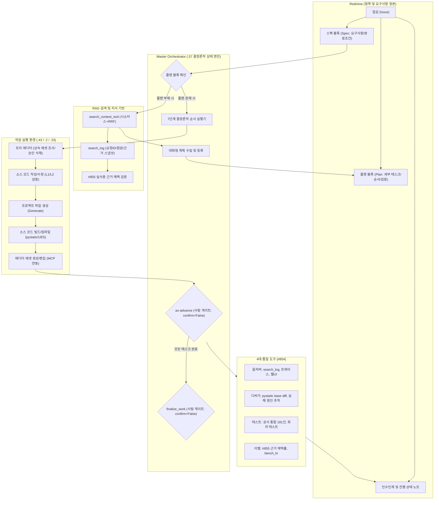
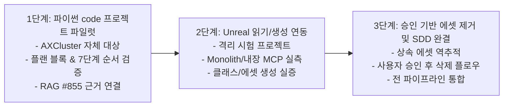

> 작성: Gemini (agy 1.4.11 · gemini-3.8-flash-medium) · 실행: `master.work.gemini_report` · 2026-10-31 02:11 · 프로젝트 AXCluster
> 자료: src/docs/milestones/7-improvements.md, src/docs/orchestrator-handoff.md, src/docs/orchestrator-rules.md, src/evidence/mcp-search-lines461-549.txt, src/evidence/register-selected.txt, src/evidence/review-selected.txt, src/master/bench_kr.py, src/master/client/setup_host.py, src/master/context_search/search.py, src/master/context_search/search_log.py, src/master/context_synth/plan_register.py, src/master/projects/profile.py, src/master/work/pystatic.py, src/redmine/issue-211.md, src/redmine/issue-729.md, src/redmine/issue-791.md, src/redmine/issue-815.md, src/redmine/issue-820.md, src/redmine/issue-826.md, src/redmine/issue-837.md, src/redmine/issue-839.md, src/redmine/issue-840.md, src/redmine/issue-850.md, src/redmine/issue-851.md, src/redmine/issue-852.md, src/redmine/issue-854.md, src/redmine/issue-855.md, src/redmine/issue-856.md, src/reports/research/2026-10-31-211-rag-usage-validation-codex-verification.md, src/web/official-sources.md
> 검증: Codex 핵심 주장 9항목 대조 — 일치 6 · 불일치/과대해석 3. [검증 불일치] 교대 시 승인 무효화, #851 선행관계·#820 표본 해석, Monolith loopback 설정 가능성. 본문은 원문 보존. 최종 HTML 및 2026-10-31-code-factory-sdd-verification.md를 함께 읽는다. 범위 검사(자동): 인용 80개 — 범위 안 80 · 범위 밖 0 · 파일 없음 0 · 읽기 실패 0
> 소요 272초 · 토큰 입력 164287 / 출력 22021 / 캐시읽기 1194274

# AX RAG 기반 코드 팩토리 및 스펙 주도 개발(SDD) 확장 조사 보고서

## 1. 요약 (Executive Summary)

본 보고서는 AX 클러스터의 기존 RAG(Retrieval-Augmented Generation) 시스템과 분산 작업 파이프라인 자산을 기반으로, Redmine 중심의 코드 팩토리 및 스펙 주도 개발(SDD, Spec-Driven Development) 체계로 확장하기 위한 현황 분석, 기술적 개선점, 그리고 단계적 실행 방안을 제시하는 의사결정 보고서다.

현재 AX 시스템은 다중 채널 검색(BM25 + Vector)과 사용자 원문 기반 추적 로그(`src/evidence/mcp-search-lines461-549.txt:1-37`, `src/master/context_search/search_log.py:1-60`), 프로젝트 프로필 분기(`src/master/projects/profile.py:45-60`), 분산 워커 파이프라인(`src/evidence/register-selected.txt:28-69`), 정적/동적 다층 검증 게이트(`src/master/work/pystatic.py:1-21`, `src/evidence/review-selected.txt:34-84`) 등 강력한 인프라 자산을 이미 실증하여 보유하고 있다. 그러나 이를 상위 레벨의 '일감 요구사항 → 상세 스펙 → 실행 플랜 → 코드/에디터 작업 → 품질 검증'으로 매끄럽게 연결하는 고리에는 다음과 같은 핵심 결함과 공백이 존재한다:

1. **RAG 검색 및 근거 연결의 단절**: BM25 단독 히트 시 메타데이터 및 발췌 누락(`src/redmine/issue-851.md:9-13`), `find_history`의 단순 연속 부분문자열 검색 한계(`src/redmine/issue-852.md:9-13`), 검색 결과 존재와 실제 개발 반영 사이의 증거 연결 부재(`src/redmine/issue-855.md:13-20`).
2. **실행 플랜 영역의 부재**: 기존 `plan_register.py`는 주간 코드리뷰 개선 플랜 MD 등록기일 뿐(`src/master/context_synth/plan_register.py:1-5`, `src/master/context_synth/plan_register.py:275`), 일반 실행 플랜 엔진은 아직 아이디어 단계(`src/redmine/issue-826.md:8-10`)에 머물러 있음.
3. **언리얼 에디터 편집 및 검증 도구의 미실증**: Monolith 및 언리얼 내장 MCP에 대한 외부 문서는 존재하나, 사내 워커 환경에서의 실제 설치, UE 버전 호환성, 에디터 세션 제어는 전혀 검증되지 않음(`src/redmine/issue-856.md:13-18`, `src/web/official-sources.md:14, 17`).

따라서 본 보고서는 복잡한 언리얼 엔진 환경으로 즉시 확장하는 대신, 파이썬 기반 `kind: code` 프로젝트에서 좁은 파일럿을 선행 검증한 뒤, 점진적으로 Unreal Engine 읽기/생성, 사용자 승인 기반 에셋 제거 순으로 확장하는 3단계 접근 전략을 제안한다. 또한 기존의 fail-closed 사람 승인 게이트(`confirm=False`) 원칙을 엄격히 준수하며 임의의 필수 승인 게이트를 추가하지 않는다(`src/docs/orchestrator-rules.md:24-25, 44`).

---

## 2. 웹 시사점 (Web / Industry Insights)

외부 기술 동향은 검증된 공식 문서(`src/web/official-sources.md:3-17`)만을 기반으로 조사하였으며, AX 시스템 확장에 직접적인 시사점을 제공한다.

### W1. GitHub Spec Kit
* 출처: https://github.github.com/spec-kit/quickstart (`src/web/official-sources.md:4`)
* **핵심 내용**: 명세(Spec) 작성, 모호점 해소, 기술 계획(Plan) 수립, 세부 태스크 분해, 산출물 일관성 분석, 구현, 수렴 확인의 전체 수명주기를 표준화한다. 특히 `spec.md`, `plan.md`, `tasks.md`로 산출물 역할을 분리한다(`src/web/official-sources.md:5`).
* **AX 시사점**: Redmine 일감 본문에서 요구사항(스펙)과 작업 순서/방법(플랜)을 분리하고, 플랜이 없는 경우 곧바로 코딩에 들어가지 않고 대화를 통해 세부 태스크를 합의·등록하는 #826 구상의 정당성을 뒷받침한다.

### W2. Anthropic 장기 에이전트 작업 (Long-Running Agent Harnesses)
* 출처: https://www.anthropic.com/research/effective-harnesses-for-long-running-agents (`src/web/official-sources.md:7`)
* **핵심 내용**: 초기 환경 준비와 후속 점진적 작업을 명확히 분리하고, 기능 목록, 진행 기록, Git 이력, 실제 사용 경로 테스트를 통해 다중 세션 간 연속성을 유지한다(`src/web/official-sources.md:8`).
* **AX 시사점**: 세션 교대 시 인수인계 문서와 Git 리비전 대조를 중시하는 AX의 교대 규약(`src/docs/orchestrator-rules.md:121-137`)과 일치한다. 단, 외부 문서의 자동 커밋 예시는 매번 승인을 거치는 AX의 `git-commit-needs-approval` 규칙(`src/docs/orchestrator-rules.md:24`)을 대체할 수 없다.

### W3. GitHub Copilot 작업 지침 (Cloud Agent Best Results)
* 출처: https://docs.github.com/en/copilot/tutorials/cloud-agent/get-the-best-results (`src/web/official-sources.md:10`)
* **핵심 내용**: 명확한 문제 정의, 완료 조건, 수정 대상 파일 지침이 포함된 좁은 범위의 일감을 권장하며, 실제 코딩 전 저장소 탐색과 계획 합의, 저장소별 빌드/테스트 지침 준수를 강조한다(`src/web/official-sources.md:11`).
* **AX 시사점**: 무제한적인 자율 탐색보다 작업 경계와 대상 파일이 명시된 조각 단위 작업(#815, #820)이 신뢰성이 높음을 보여준다.

### W4. Monolith 오픈소스 에디터 MCP
* 출처: https://github.com/tumourlove/monolith (`src/web/official-sources.md:13`)
* **핵심 내용**: MIT 라이선스 기반 언리얼 엔진 플러그인으로, UE5.7/5.8 소스 트리 및 사전 빌드 ZIP 지원, native proxy, 프로젝트 `.mcp.json`, editor endpoint 및 도구 discovery를 제공한다(`src/web/official-sources.md:14`).
* **AX 시사점**: 에디터 조작 도구로서의 가능성이 있으나, LAN listener 노출 위험이 있으므로 보안을 위해 로컬 연결/릴레이 구조가 필수적이며, upstream 문서 내용일 뿐 사내 머신(.2, .33)에서의 실증은 아직 전무하다.

### W5. Epic UE5.8 Unreal MCP
* 출처: https://dev.epicgames.com/documentation/unreal-engine/unreal-mcp-in-unreal-editor (`src/web/official-sources.md:16`)
* **핵심 내용**: 에픽게임즈 공식 Experimental 기능으로, ModelContextProtocol 서버와 Toolset Registry를 분리하고 로컬 HTTP 연결을 통해 게임 스레드 직렬 호출을 수행한다. Python/C++ 확장과 도구 새로고침을 지원하나 UFUNCTION 추가 시 에디터 재시작이 요구된다(`src/web/official-sources.md:17`).
* **AX 시사점**: 공식 표준 기능으로 발전할 가능성이 높으나 실험적 기능이며, 현재 환경에서 지원 여부는 별도 실측이 선행되어야 한다.

---

## 3. 현재 구현과 근거 수준 (Current Implementation & Evidence Level)

시스템 구성 요소를 엄격한 기준에 따라 5개 계층으로 분류하여 평가한다:
* **[구현됨(소스확인)]**: 소스 코드 상에 구현이 확인되고 단위/통합 검증이 존재하는 상태.
* **[실사용확인(기록)]**: 실제 운영 환경에서 호출되어 로그나 결과 스냅샷이 검증된 상태.
* **[진행/미완(이슈)]**: 구체적 결함이 식별되어 수정 중이거나 잔여 작업이 존재하는 상태.
* **[계획(아이디어)]**: Redmine 아이디어 일감 등으로 요구사항이 정리되었으나 미착수 상태.
* **[제안(본 보고서)]**: 본 보고서에서 새롭게 제시하는 아키텍처 및 계약.

### 3.1 RAG 검색 및 질의 추적
* **통합 검색 인터페이스 및 로깅** `[구현됨(소스확인)]` / `[실사용확인(기록)]`:
  `search_context_tool`을 단일 입구로 하여 대괄호 토큰 추출, 시소러스 확장, 벡터+BM25 융합 검색(RRF)을 수행한다(`src/evidence/mcp-search-lines461-549.txt:1-37`). `search_log.py`는 일자별 `search_logs/YYYY-MM-DD.jsonl`에 누적 기록하며, 요청자 원문과 LLM 질의, 반환 순위 및 점수를 보존한다(`src/master/context_search/search_log.py:1-60`, `src/redmine/issue-837.md:49-56`).
* **실사용 로그 스냅샷 진단** `[실사용확인(기록)]`:
  2026-10-31 검증 당시 스냅샷 기준, user_command 19건 검색(17개 고유 request_id)이 확인되었다(`src/reports/research/2026-10-31-211-rag-usage-validation-codex-verification.md:9-16`). 이는 이전 분석 스냅샷이며 현재 누적 로그 총량이 아니다.
* **RAG 개발 채택 직접증거의 한계** `[진행/미완(이슈)]`:
  이전 Gemini 분석에서 주장한 '개발 직접 활용 8건'은 Codex 2차 검증에서 불일치 판정되었다(`src/reports/research/2026-10-31-211-rag-usage-validation-codex-verification.md:32`). 단순히 동일 파일이 반환되고 수정되었다는 사실은 근거 채택의 직접 증거가 될 수 없으며, 실제 로그의 `session_id`와 `work_id`는 모두 빈 값이었다(`src/reports/research/2026-10-31-211-rag-usage-validation-codex-verification.md:15`). 이에 따라 요구→질의→반환근거→개발채택을 단계별로 분리 평가하는 #855가 분리 등록되었다(`src/redmine/issue-855.md:13-20`).
* **BM25 단독 히트 결함** `[진행/미완(이슈)]`:
  `master/context_search/search.py:126`에서 BM25 단독 히트 문서의 경우 `meta`와 `excerpt`가 빈 값으로 반환된다(`src/redmine/issue-851.md:9-13`). 스냅샷 분석에서도 반환 문서 100건 중 25건이 비어 있었으며 상위 2위 누락도 3건 존재했다(`src/reports/research/2026-10-31-211-rag-usage-validation-codex-verification.md:13-14, 33`).
* **검색어 순서 종속 결함** `[진행/미완(이슈)]`:
  `history_harvest.py:640-641`에서 질의 전체를 단순 부분문자열로 검색하여, 단어 순서가 바뀌거나 조사 등이 생략되면 0건으로 처리된다(`src/redmine/issue-852.md:9-26`).

### 3.2 분산 파이프라인 및 승인 계약
* **프로젝트 프로필 분기** `[구현됨(소스확인)]`:
  프로젝트를 `unreal`, `index_only`, `code`로 명시 분기하며(`src/master/projects/profile.py:45-54`), `code` 타입(AXCluster 등)은 `work_exts: [.py]`에 맞춰 C++ 빌드 대신 파이썬 정적 검사 및 공식 통합 검사 181건을 수행한다(`src/master/work/pystatic.py:1-21`).
* **작업 등록 및 지휘자 스탬프** `[구현됨(소스확인)]`:
  `create_work`는 작업 브랜치(`task/<work_id>/base`) 생성을 위해 `work_id`를 선발급하고 등재 시점의 지휘자 모드를 고정 스탬프한다(`src/evidence/register-selected.txt:33-53`).
* **Fail-Closed 승인 게이트** `[구현됨(소스확인)]`:
  작업 브랜치 전진(`advance_work`)과 메인 머지(`finalize_work`)는 모두 `confirm=False`가 기본값이며, 사람의 대화형 승인 발화가 유일한 실행 트리거다(`src/docs/orchestrator-rules.md:24-25`, `src/evidence/review-selected.txt:5-9, 40-42`).

### 3.3 Redmine 플랜 및 에디터 연동 현황
* **`plan_register.py`의 실체** `[구현됨(소스확인)]`:
  `plan_register.py`는 코드리뷰 산출물인 주간 개선 플랜 MD 파일을 읽어 Redmine의 `코드리뷰` 트래커 이슈로 등록/갱신하는 전용 모듈이다(`src/master/context_synth/plan_register.py:1-11`). frontmatter의 `type == "improvement_plan"`을 검사하므로(`src/master/context_synth/plan_register.py:275`), 범용 개발 실행 플랜 등록 모듈이 아니다.
* **Redmine 스펙/플랜 결정적 플로우** `[계획(아이디어)]`:
  일감 본문의 스펙과 플랜 블록을 기반으로 버전 동기화부터 에디터 작업까지 연결하는 플로우 구상은 아이디어 상태다(`src/redmine/issue-826.md:8-10`).
* **Monolith / 내장 MCP 에디터 연동** `[계획(아이디어)]`:
  에디터 조작 스킬 및 MCP 개발/배포 계획은 아이디어 상태이며 실물 조사는 미착수 상태다(`src/redmine/issue-856.md:8-13`).

---

## 4. 개선 우선순위 (Improvement Priorities)

단계 간 의존성과 파이프라인 안정성을 고려한 정밀 개선 순서는 다음과 같다:

```
[1단계: RAG 근거성 복구]
  #851 (BM25 메타/발췌 복구) ──> #855 (요구-질의-근거-채택 연결 평가)
  #852 (find_history 검색 개선) ┘

[2단계: 파이프라인 안전성 확보]
  #791 (후속 라운드 실패 시 전체 반려 방지)
  #820 (지시 범위 밖 변경 ⑦게이트 고지)

[3단계: 운영 근거 및 모델 체인]
  #839 (doc_sync 스냅샷 파일 근거)
  #840 (로컬 조각 클라우드 재작업 후보 보관)

[4단계: SDD 실행 플로우 정립]
  #826 (플랜 블록 구조화 및 7단계 순서 강제)
  #854 (품질 도구 4대분류 체계화)

[5단계: 언리얼 에디터 연동 실증]
  #856 (Monolith/Epic MCP 로컬 검증 및 안전 격리)
```

1. **최우선: RAG 검색 무결성 및 근거 평가 (#851, #852 → #855)**
   * **사유**: 플랜 수립 시 RAG를 통해 기존 소스 및 설계를 대조해야 하는데(`src/redmine/issue-826.md:27`), BM25 단독 검색 결과가 빈 발췌로 나가면(#851) 정답 문서가 누락되거나 무시된다. 또한 검색 결과가 실제 개발에 쓰였는지 분리 평가하는 기준(#855)이 먼저 서야 RAG 기반 SDD의 신뢰성을 측정할 수 있다.
2. **차우선: 다중 라운드 워커 파이프라인 결함 해소 (#791, #820)**
   * **사유**: #791 드라이런 결과, 2라운드 이상에서 후속 조각 중 하나라도 진짜 실패가 발생하면 1라운드에서 승인 전진된 작업까지 포함해 work 전체가 rejected 되고 동일 work에서 개선요청이 차단되는 결함(시나리오 D)이 남아 있다(`src/redmine/issue-791.md:38-40`). 또한 조각이 지시 범위 밖을 수정하는 문제(#820)는 드라이런 실측 결과 층1 차단 시 정상적인 연쇄 수정까지 18% 오탐되므로, ⑦ 게이트 고지(b안)로 사람에게 판단 정보를 제공해야 한다(`src/redmine/issue-820.md:54-66`).
3. **운영 문서 및 클라우드 회복 체인 (#839, #840)**
   * **사유**: doc_sync에 Redmine/운영 근거를 스냅샷 파일로 제공하는 방식 확정(#839 사용자 결정, `src/redmine/issue-839.md:39-41`)과 한도 소진으로 로컬에서 작성된 조각을 클라우드 회복 후 별도 후보로 보관하는 방식(#840 사용자 결정, `src/redmine/issue-840.md:47-51`)을 구현한다.
4. **Redmine SDD 실행 플로우 및 품질 도구 정립 (#826, #854)**
   * **사유**: 스펙/플랜 블록을 정의하고, 플랜 유무에 따른 대화형 수립 절차와 7단계 실행 순서를 파이썬 함수로 강제한다.
5. **언리얼 에디터 연동 실증 (#856)**
   * **사유**: 에디터 조작은 엔진 세션과 대화형 환경에 의존하므로 충분한 사전 검증 없이 파이프라인에 편입시키면 안 된다.

---

## 5. 목표 구조 (Target Architecture)

RAG 시스템과 Redmine 일감 관리, 분산 실행 파이프라인이 유기적으로 결합된 SDD 코드 팩토리의 목표 아키텍처는 다음과 같다.



### 5.1 다중 정본 및 불일치 해소 계약
1. **이중 정본(Dual Source-of-Truth) 원칙**:
   * 요구사항, 일감 상태, 진행 여부의 유일한 정본은 **Redmine**이다(`src/docs/orchestrator-rules.md:58`).
   * 코드, 빌드 스크립트, 버전 이력의 정본은 **Git 저장소**다.
   * 일감에 '완료'로 기록되어 있어도 실제 Git 브랜치 및 검사 결과와 대조하여 불일치할 경우 진행을 멈추고 보고한다(`src/docs/orchestrator-rules.md:130-132`).
2. **오래된 승인(Stale Approval) 방지**:
   * 세션이 교대되거나 중간에 작업이 중단된 경우, 이전 세션의 승인은 무효화되며 새로운 대화에서 명시적 승인을 다시 받는다(`src/docs/orchestrator-rules.md:24-25, 133-135`).
3. **동시 수정(Concurrent Modification) 방지**:
   * 같은 작업을 지휘하는 세션은 한 번에 하나만 존재해야 하며(`src/docs/orchestrator-rules.md:128-129`), Git 작업 브랜치(`task/<work_id>/base`)는 독립된 worktree 격리 환경에서 관리된다(`src/evidence/review-selected.txt:11-14, 44-45`).
4. **부분 실패(Partial Failure) 및 재개(Resume) 계약**:
   * 태스크 실행 도중 실패(rc≠0, 게이트 차단)가 발생하면 자율적으로 코드를 고치려 하지 않고 원인을 플랜 영역에 기록한 후 즉시 멈춘다(`src/docs/orchestrator-rules.md:26`).
   * 재개 시에는 플랜 블록의 마킹 상태와 실제 작업 트리의 상태를 재대조하여 실패 지점부터 이어간다(`src/redmine/issue-826.md:65`).

---

## 6. 실행 플랜·태스크 계약 (Execution Plan & Task Contracts)

#826에서 최종 확정된 7단계 태스크 실행 순서를 엄격히 준수한다. 특히 Git/SVN 업데이트로 인해 대상 코드가 달라질 수 있으므로 버전 동기화가 프리 에디터 작업보다 반드시 선행되어야 한다(`src/redmine/issue-826.md:35, 93`).

### 6.1 7단계 실행 순서
1. **버전 동기화·상태 확인**: 작업 기준 리비전과 작업 브랜치를 최신 상태로 동기화하고 변경점을 조사한다.
2. **프리 에디터 작업**: 소스 변경 전 에디터에서 처리할 작업을 수행한다. 클래스 제거의 경우, 상속 에셋을 조사하여 **사용자 승인을 받은 후 에셋을 먼저 제거**한다(`src/redmine/issue-826.md:39, 59`).
3. **소스 작업**: 플랜에 따라 클래스 추가·수정·제거 등 코드 작업을 수행한다.
4. **프로젝트 제네레이트**: 언리얼 프로젝트에서 클래스 추가/제거 등으로 인해 프로젝트 파일 재생성이 필요한 경우 실행한다.
5. **소스코드 빌드**: 코드 프로젝트는 파이썬 정적 검사(`pystatic`), 언리얼 프로젝트는 소스 빌드를 실행하고 컴파일 결과를 검증한다.
6. **에디터 작업**: 언리얼 프로젝트에서 필요한 에셋 생성, 블루프린트 연결 작업을 수행한다.
7. **작업 상태 확인·인수인계 기록**: 결과를 확인하고 완료 태스크를 마킹하며, 미완료 내역과 검증 근거를 플랜 영역에 누적 기록한다.

### 6.2 승인 게이트 연동
* 기존 파이프라인의 사람 승인 게이트는 **작업 브랜치 전진(`ax-advance`)**과 **메인 머지(`finalize_work`)** 둘뿐이다(`src/docs/orchestrator-rules.md:25`).
* 커밋 및 푸시는 매번 명시적 승인을 거친다(`src/docs/orchestrator-rules.md:24`).
* 본 SDD 구상은 기존 승인 규칙을 그대로 따르며, **임의의 새로운 필수 승인 게이트를 추가하지 않는다**(`src/docs/orchestrator-rules.md:44`, `src/redmine/issue-826.md:79`). 단, 에셋 영구 삭제의 경우 기존 안전 규칙에 따라 사전 동의를 받는다(`src/redmine/issue-826.md:59`).

### 6.3 태스크 실행 스키마 (제안 스키마)
```json
{
  "$schema": "https://json-schema.org/draft/2020-12/schema",
  "title": "AX_SDD_Task_Execution_Record",
  "description": "Redmine 플랜 블록과 동기화되는 태스크 단위 실행 및 추적 제안 스키마",
  "type": "object",
  "required": [
    "issue_id",
    "spec_version",
    "plan_version",
    "task_id",
    "dependencies",
    "status",
    "base_revision",
    "request",
    "search",
    "evidence",
    "result"
  ],
  "properties": {
    "issue_id": { "type": "integer", "description": "Redmine 이슈 번호" },
    "spec_version": { "type": "string", "description": "참조한 스펙 버전 또는 SHA" },
    "plan_version": { "type": "string", "description": "참조한 플랜 버전 또는 시각" },
    "task_id": { "type": "string", "description": "태스크 고유 식별자 (예: T01_remove_camera_class)" },
    "dependencies": {
      "type": "array",
      "items": { "type": "string" },
      "description": "선행 태스크 식별자 목록"
    },
    "status": {
      "type": "string",
      "enum": ["pending", "in_progress", "completed", "blocked", "failed"]
    },
    "base_revision": { "type": "string", "description": "작업 시작 시점 Git commit hash" },
    "request": {
      "type": "object",
      "required": ["original_user_command", "turn_id"],
      "properties": {
        "original_user_command": { "type": "string" },
        "turn_id": { "type": "string" }
      }
    },
    "search": {
      "type": "object",
      "required": ["request_id", "search_ids"],
      "properties": {
        "request_id": { "type": "string" },
        "search_ids": { "type": "array", "items": { "type": "string" } }
      }
    },
    "evidence": {
      "type": "array",
      "items": {
        "type": "object",
        "required": ["file_id", "source_type", "relevance_confirmed"],
        "properties": {
          "file_id": { "type": "string" },
          "source_type": { "type": "string", "enum": ["bm25", "vector", "vector+bm25", "direct_read"] },
          "relevance_confirmed": { "type": "boolean" },
          "applied_lines": { "type": "string" }
        }
      }
    },
    "result": {
      "type": "object",
      "required": ["step_number", "step_name", "passed", "message"],
      "properties": {
        "step_number": { "type": "integer", "minimum": 1, "maximum": 7 },
        "step_name": { "type": "string" },
        "passed": { "type": "boolean" },
        "message": { "type": "string" },
        "affected_files": { "type": "array", "items": { "type": "string" } }
      }
    }
  }
}
```

---

## 7. Unreal 편집·배포 (Unreal Engine Editing & Distribution)

### 7.1 Monolith 및 에픽 내장 MCP 기술 비교
공식 문서(`src/web/official-sources.md:12-17`) 및 #856 등록 내용(`src/redmine/issue-856.md:12-18`)에 기초한 비교는 다음과 같다:

| 항목 | Monolith MCP (W4) | 에픽 언리얼 내장 MCP (W5) |
|---|---|---|
| 라이선스 / 상태 | MIT 라이선스 / 서드파티 오픈소스 | 에픽 공식 문서 Experimental 상태 |
| 지원 버전 / 배포 | UE5.7 / UE5.8 소스 트리 및 엔진별 사전빌드 ZIP | UE5.8 이상 내장 실험적 기능 |
| 아키텍처 | Native proxy, `.mcp.json`, editor endpoint, tool discovery | MCP Server + Toolset Registry, 로컬 HTTP 연결 |
| 스레드 모델 | Discovery 기반 원격 툴셋 호출 | 게임 스레드 직렬화(Game Thread Serialization) |
| 제약 사항 | LAN listener 보안 위험 노출 가능 | UFUNCTION 추가 시 에디터 재시작 필수 |
| AX 실측 검증 수준 | **미검증** (.2/.33 머신 설치 및 호환 실측 없음) | **미검증** (사내 PC 활성화 및 지원 여부 미측정) |

### 7.2 안전한 로컬 연결 및 보안 격리 (제안)
Monolith가 LAN listener를 직접 개방할 경우 외부 공격 표면이 발생하므로, AX 마스터는 원격 포트에 직접 접근하지 않고 워커 로컬 루프백(`127.0.0.1`) 바인딩 및 AX 전용 커맨드 어댑터를 통해서만 통신하도록 제한해야 한다(`src/web/official-sources.md:14`, [제안]).

### 7.3 대화형 세션 종속성 및 준비 검사
* 에디터 실행은 백그라운드 데몬이 아닌 대화형 로그인 세션(.2 /IT 런처, janus 로그인)이 요구된다(`src/redmine/issue-826.md:76`). 세션 ID를 고정하지 않고 기동 시점에 동적으로 검출해야 한다.
* 신규 워커 설치 및 배달을 담당하는 `setup_host.py`(`src/master/client/setup_host.py:1-20`)에 에디터 MCP 설정 병합 및 준비 검사(`cmd_check`)를 편입하되, **충분한 사전 검증 없이 상용 워커에 즉시 배포하지 않는다**(`src/redmine/issue-856.md:43`).

---

## 8. 4대 품질 도구 (Debugger, Observer, Eval, Test / #854)

#854에서 정의된 품질 도구 4대 대분류(`src/redmine/issue-854.md:11-18`)를 AX 클러스터의 실제 기능 및 검증 자산과 매핑한다:

```
┌────────────────────────────────────────────────────────────────────────┐
│                       4대 품질 도구 체계 (#854)                         │
├────────────────────┬────────────────────┬──────────────────────────────┤
│ 1. 옵저버 (Observer)│ "지금 무슨 일이?"  │ search_log.py 요청 추적 (#837)│
│                    │                    │ /rag-logs 웹UI 조회          │
├────────────────────┼────────────────────┼──────────────────────────────┤
│ 2. 디버거 (Debugger)│ "왜 잘못됐는가?"   │ pystatic base 비교 검사 (#804)│
│                    │                    │ 층1/층2 실패 원인 분석       │
├────────────────────┼────────────────────┼──────────────────────────────┤
│ 3. 테스트 (Test)   │ "요구조건 만족하나" │ 공식 통합 181건 검사          │
│                    │                    │ 단위 회귀 테스트 8,800+건     │
├────────────────────┼────────────────────┼──────────────────────────────┤
│ 4. 이밸 (Eval)     │ "얼마나 좋은가?"   │ #855 요구-질의-근거-채택 평가 │
│                    │                    │ bench_kr 정답 집합 벤치마크   │
└────────────────────┴────────────────────┴──────────────────────────────┘
```

1. **옵저버 (Observer — "지금 무슨 일이 일어나는가?")**:
   * **기능**: RAG 검색 시 사용자 원문, LLM 질의, 확장 쿼리, 반환 발췌, 채널 순위 및 점수를 실시간 로깅(`src/master/context_search/search_log.py:1-60`).
   * **자산**: `/rag-logs` 웹UI 상세 페이지 및 일자별 JSONL 누적 로그(`src/redmine/issue-837.md:49-56`).
2. **디버거 (Debugger — "왜 잘못됐는가?")**:
   * **기능**: 실패한 코드 및 빌드 산출물의 원인 추적. 특히 `pystatic.py`는 base 리비전에 이미 존재하던 결함과 이번 라운드에서 발생한 결함을 분리하여 불필요한 실패 판정을 방지함(`src/master/work/pystatic.py:14-18`).
   * **자산**: #791, #820에서 활용된 scratchpad 격리 드라이런 기법(`src/docs/orchestrator-handoff.md:99-108`).
3. **테스트 (Test — "정해진 요구사항을 만족하는가?")**:
   * **기능**: 단위·통합·계약의 결정론적 통과 여부 판정.
   * **자산**: 공식 통합 검사 181건(`Ran 181 OK`), 187개 파이썬 전수 회귀 테스트 8,873건(`src/redmine/issue-850.md:77`), pyflakes 및 mypy call-arg 게이트(`src/master/work/pystatic.py:40-42`).
4. **이밸 (Eval — "결과가 얼마나 좋은가?")**:
   * **기능**: 정답 벤치마크 기반의 검색/모델 품질 측정 및 산출물 정밀 비교.
   * **자산**: `bench_kr.py` 정답표 측정 하네스(`src/master/bench_kr.py:90-108`), #855에서 구축 예정인 '요구사항 → 질의 → 반환근거 → 코드 채택' 4단계 연결 평가 체계(`src/redmine/issue-855.md:24-34`).

---

## 9. 단계별 로드맵·성공 기준 (Phased Roadmap & Success Criteria)

미측정된 가상의 수치 목표 대신, 검증 가능한 파일럿 완료 조건과 수집 기준 지표를 제시한다.



### 9.1 단계별 세부 계획
* **1단계: `kind: code` (Python) 좁은 파일럿 (AXCluster 대상)**
  * **내용**: 언리얼 에디터 없이 파이썬 코드로만 구성된 AXCluster 프로젝트에서 Redmine 일감에 스펙/플랜 블록을 생성하고, RAG 대조를 거쳐 코드를 수정한 뒤 7단계 중 관련 단계(1, 3, 5, 7)를 실행한다.
  * **완료 조건**:
    * Redmine 일감 1건 이상에서 플랜 수립부터 코드 반영, `pystatic` 및 통합 181건 검사 통과, 인수인계 노트 갱신까지 중단 없이 완주.
    * #855 체계에 따라 RAG 반환 근거가 코드에 채택된 증거(줄 번호 및 심볼)가 1건 이상 대조 확인됨.
  * **수집 지표**: 플랜 수립 대화 턴 수, 층1/층2 재시도 횟수, RAG 근거 채택 여부(직접/간접/미확인 비율).
* **2단계: Unreal Engine 읽기 및 생성 파일럿 (격리 테스트 프로젝트 대상)**
  * **내용**: 승인된 격리 언리얼 프로젝트에서 Monolith 또는 에픽 내장 MCP를 로컬 바인딩으로 연결하여, 클래스 조회 및 상속 에셋/블루프린트 생성 작업을 실증한다.
  * **완료 조건**:
    * 로컬 editor endpoint 연결 상태 및 tool discovery가 결정론적으로 통과.
    * C++ 신규 클래스 추가 후 소스 빌드 및 이를 상속하는 에셋 생성 성공.
  * **수집 지표**: 에디터 연결 소요 시간, MCP 도구 호출 실패율, 에디터 세션 유지 안정성.
* **3단계: 승인 기반 에셋 제거 및 전 파이프라인 통합**
  * **내용**: 클래스 제거 시 선행 에디터 작업(상속 에셋 조사 → 사용자 허락 → 에셋 먼저 제거 → 소스 삭제 → 빌드)을 실증한다(`src/redmine/issue-826.md:58-61`).
  * **완료 조건**:
    * 사용자의 명시적 승인 전에는 에셋이 삭제되지 않음을 강제 검증.
    * 에셋 제거 후 컴파일 및 린트 오류 없이 상태가 정상 기록됨.

---

## 10. 미결 결정·한계 (Open Decisions & Limitations)

### 10.1 사용자 결정 대기 항목 (Open Decisions)
1. **#839 doc_sync 운영 근거 스냅샷 파일 정책**:
   * 결정된 (a)스냅샷 파일 방식(`src/redmine/issue-839.md:39-41`)에 대해, 스냅샷 생성 주기, 보존 위치, 민감 정보 필터링 기준 확정 필요.
2. **#840 로컬 생성 조각의 클라우드 회복 후 재작업 보관 위치**:
   * 결정된 (a)후보 보관 방식(`src/redmine/issue-840.md:47-51`)에 대해, 후보 저장 디렉토리 및 `ax-advance` ⑦ 게이트 화면에서 사람에게 후보를 제시하고 채택하는 UI/CLI 동작 확정 필요.
3. **#791 다중 라운드 후속 실패의 종결 처리 방식**:
   * 후속 라운드에서 코드 실패 발생 시 전체 work를 `rejected`로 종결할지, 라운드 실패로 한정하여 같은 work에서 재작업/개선요청을 허용할지 결정 필요(`src/redmine/issue-791.md:39-40`).
4. **#820 지시 범위 밖 변경 고지 구현**:
   * 66개 조각 실측 결과 정당한 연쇄 수정 오탐(18%)으로 인해 게이트 차단(a)은 불가하며, ⑦ 게이트 고지(b)로 구현할지 여부 결정 필요(`src/redmine/issue-820.md:64-66`).
5. **#856 에디터 MCP 기술 선택 및 배포 방식**:
   * Monolith vs 에픽 내장 MCP 중 우선 실증 대상 선정 및 소스 배포 vs 빌드 ZIP 배포 방식 결정 필요(`src/redmine/issue-856.md:16-18`).

### 10.2 시스템 고유의 한계 (Limitations)
* **상용 모델 한도 및 교차 계열 제약**: 작성 레인(Codex/Agy)과 검토 레인(Agy/Claude)이 한도를 공유하므로 대규모 연속 작업 시 한도 고갈 위험이 상존함(`src/docs/orchestrator-rules.md:73`, `src/redmine/issue-840.md:9-14`).
* **에디터 비결정성 및 대화형 로그인 종속**: 언리얼 에디터는 GUI 세션과 그래픽 드라이버에 종속되며, C++ 컴파일이나 블루프린트 컴파일 시 백그라운드 크래시 발생 가능성이 헤드리스 환경보다 높음(`src/redmine/issue-826.md:76-78`).

---

## 11. Codex 검증 핵심 주장 6개

Codex가 보고서의 사실성을 독립 대조할 수 있도록 핵심 주장을 사실(Fact)과 제안(Proposal)으로 엄격히 구분하여 기술한다:

1. **RAG 실사용 스냅샷 및 BM25 발췌 누락**
   * **[사실]**: 2026-10-31 분석 당시 user_command 스냅샷은 19검색 / 17개 고유 request_id였으며(`src/reports/research/2026-10-31-211-rag-usage-validation-codex-verification.md:11`), 반환 문서 100건 중 25건이 `source="bm25"` 단독 히트 시 `meta`와 `excerpt`가 빈 값으로 나가는 결함 때문이었다(`src/master/context_search/search.py:126`, `src/redmine/issue-851.md:9-13`).
   * **[사실]**: Gemini의 이전 '개발 직접 활용 8건' 주장은 Codex 2차 검증에서 증거 불충분으로 검증 불일치 판정되었다(`src/reports/research/2026-10-31-211-rag-usage-validation-codex-verification.md:32`).
2. **`plan_register.py`의 기능 범위**
   * **[사실]**: `plan_register.py`는 주간 코드리뷰 개선 플랜 MD 파일을 읽어 `코드리뷰` 트래커 이슈를 등록/갱신하는 전용 모듈이며(`src/master/context_synth/plan_register.py:1-11`), `type != "improvement_plan"`인 경우 오류를 반환하므로 범용 개발 플랜 등록 기능이 아니다(`src/master/context_synth/plan_register.py:275-276`).
3. **#826 실행 순서 및 에셋 제거 승인 규칙**
   * **[사실]**: #826의 최종 정정된 실행 순서는 1) 버전 동기화·상태 확인 → 2) 프리 에디터 작업 → 3) 소스 작업 → 4) 프로젝트 제네레이트 → 5) 소스코드 빌드 → 6) 에디터 작업 → 7) 작업 상태 확인·인수인계 기록이다(`src/redmine/issue-826.md:37-45`).
   * **[사실]**: 클래스 제거 시 프리 에디터에서 상속 에셋을 조사한 후 사용자 허락을 받아 에셋을 먼저 제거해야 하며, 클래스 파일을 먼저 지우지 않는다(`src/redmine/issue-826.md:58-61`).
4. **기존 승인 계약 준수 및 게이트 추가 금지**
   * **[사실]**: 사람 게이트는 ⑺ 작업 브랜치 전진(`ax-advance`)과 finalize(`main` 머지) 둘뿐이며 `confirm=False`가 기본이다(`src/docs/orchestrator-rules.md:25`, `src/evidence/review-selected.txt:5-9, 40-42`). 커밋·푸시는 매번 명시적 승인을 받아야 하며(`src/docs/orchestrator-rules.md:24`), 새로운 필수 승인 게이트를 임의로 늘리지 않는다(`src/docs/orchestrator-rules.md:44`).
5. **Monolith 및 언리얼 내장 MCP의 실측 상태**
   * **[사실]**: Monolith(W4, MIT 라이선스) 및 Epic UE5.8 MCP(W5, Experimental)는 공식 웹 문서상 확인된 사양이나(`src/web/official-sources.md:12-17`), 사내 워커 머신(.2, .33)에서의 설치, 호환성, 실제 에디터 편집 동작은 일체 검증되지 않았다(`src/redmine/issue-856.md:13-18`, `src/web/official-sources.md:14, 17`).
   * **[제안]**: Monolith의 LAN listener 노출 위험을 방지하기 위해 로컬 루프백 바인딩과 AX 커맨드 릴레이/어댑터 구조를 적용해야 한다(`src/web/official-sources.md:14`).
6. **주요 미완 일감 간 의존 관계 및 측정 결과**
   * **[사실]**: #851(BM25 발췌 누락)은 #855(근거 채택 검증)의 선행 조건이며(`src/redmine/issue-855.md:34`), #820(지시 범위 밖 변경) 드라이런 결과 66개 조각 중 30개에서 범위 밖 변경이 감지되었으나 표본 3/3이 정당한 연쇄 수정 오탐으로 나타나 층1 차단은 불가능하고 ⑦ 게이트 고지가 적합함이 확인되었다(`src/redmine/issue-820.md:54-66`).
   * **[사실]**: #791(다중 라운드 후속 실패)은 #821로 층2 판단 불가는 해소되었으나, 후속 라운드에 진짜 실패가 1건이라도 있으면 전체 work가 `rejected`로 종결되는 결함이 남아 있다(`src/redmine/issue-791.md:37-41`).
