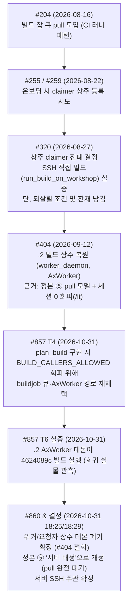
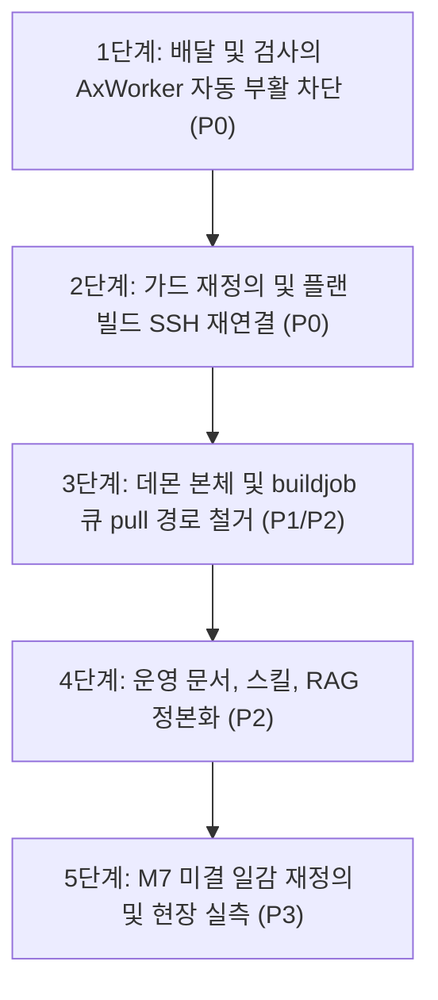

> 작성: Gemini (agy 1.4.12 · gemini-3.8-flash-medium) · 실행: `master.work.gemini_report` · 2026-10-31 19:08 · 프로젝트 AXCluster
> 자료: MANIFEST.txt, src/AGENTS.md, src/AXCluster/context/master/client/bundle.md, src/AXCluster/context/master/test_residency.md, src/AXCluster/context/master/work/runner.md, src/AXCluster/context/master/work/worker_daemon.md, src/AXCluster/history/2026-10-31_1825_워커·요청자_상주_데몬_폐기,_서버_SSH_주관_확정_—_#404_복원_철회,_#857.md, src/AXCluster/history/2026-10-31_1829_정본_7단계_⑤_를_「서버가_다음_조각을_배정한다」로_변경_—_pull_모델_폐기.md, src/CLAUDE.md, src/PLAN.md, src/README.md, src/client/README.md, src/client/init/__init__.py, src/client/init/bootstrap.py, src/client/init/residency.py, src/client/linux/README.md, src/client/runtime/__init__.py, src/client/runtime/client_mcp.py, src/client/runtime/fix_flow.py, src/client/runtime/ontology_cache.py, src/client/runtime/session1_conductor.py, src/client/runtime/winsession.py, src/client/windows/README.md, src/docs/1-background.md, src/docs/10-references.md, src/docs/11-agent-conduct.md, src/docs/12-multi-project.md, src/docs/13-request-tagging.md, src/docs/14-onboarding-runbook.md, src/docs/15-orchestrator-handoff.md, src/docs/16-worker-orchestrator-mode.md, src/docs/17-review-queue.md, src/docs/2-architecture.md, src/docs/3-open-items.md, src/docs/4-work-loop.md, src/docs/5-master-orchestration.md, src/docs/5_5-project-isolation.md, src/docs/6-node-failover.md, src/docs/7-master-gpu.md, src/docs/8-git-authority.md, src/docs/9-gajae-code.md, src/docs/9_5-task-queue.md, src/docs/document-registry.json, src/docs/document-sync.md, src/docs/milestones/1-infrastructure.md, src/docs/milestones/2-twin-restoration.md, src/docs/milestones/3-work-pipeline.md, src/docs/milestones/4-origin-reconciliation.md, src/docs/milestones/5-version-reconcile.md, src/docs/milestones/6-improvements.md, src/docs/milestones/7-improvements.md, src/docs/milestones/README.md, src/docs/orchestrator-handoff-history.md, src/docs/orchestrator-handoff.md, src/docs/orchestrator-rules.md, src/docs/settled-decisions.md, src/docs/windows-codex-remote.md, src/evidence/redmine-259.json, src/evidence/redmine-320.json, src/evidence/redmine-344.json, src/evidence/redmine-404.json, src/evidence/redmine-406.json, src/evidence/redmine-857.json, src/evidence/redmine-860.json, src/machines/README.md, src/machines/bc250-1.md, src/machines/llm-fitness.md, src/machines/sim-desktop-agents.md, src/machines/sim-desktop.d/bc250-access.md, src/machines/sim-desktop.d/environment.md, src/machines/sim-desktop.d/services.md, src/machines/sim-desktop.md, src/machines/win-main-33.md, src/machines/win-worker-2.md, src/master/README.md, src/master/agy_models.py, src/master/agy_probe.py, src/master/audit_issues_codex.py, src/master/auth.py, src/master/batch/__init__.py, src/master/batch/gates.py, src/master/batch/run.py, src/master/bench.py, src/master/bench_kr.py, src/master/bench_lane_codex.py, src/master/bench_layer2.py, src/master/bench_skeleton.py, src/master/bench_skeleton_codex.py, src/master/broker/__init__.py, src/master/broker/__main__.py, src/master/broker/config.py, src/master/broker/health.py, src/master/broker/routing.py, src/master/broker/server.py, src/master/canary.py, src/master/census.py, src/master/client/__main__.py, src/master/client/bundle.py, src/master/client/master_local.py, src/master/client/payload/claude_md/ModularStage.md, src/master/client/payload/claude_md/MotionForge.md, src/master/client/payload/claude_md/NS.md, src/master/client/payload/claude_md/_skeleton.md, src/master/client/payload/profile/AXCluster.yaml, src/master/client/payload/profile/KimodoMotion_WebUI.yaml, src/master/client/payload/profile/ModularStage.yaml, src/master/client/payload/profile/MotionForge.yaml, src/master/client/payload/profile/NS.yaml, src/master/client/setup_host.py, src/master/client/skills/ax-advance/SKILL.md, src/master/client/skills/ax-fix/SKILL.md, src/master/client/skills/ax-gemini/SKILL.md, src/master/client/skills/ax-infer/SKILL.md, src/master/client/skills/ax-ontology/SKILL.md, src/master/client/skills/ax-request/SKILL.md, src/master/client/skills/ax-review/SKILL.md, src/master/client/skills/ax-work/SKILL.md, src/master/client/spec.py, src/master/client/uproject.py, src/master/client/workshop/CLAUDE.code.md, src/master/client/workshop/CLAUDE.index_only.md, src/master/client/workshop/CLAUDE.md, src/master/client/workshop/README.md, src/master/client/workshop/agents/SKILL_INDEX.md, src/master/client/workshop/agents/asset-validator.md, src/master/client/workshop/agents/build-integration.md, src/master/client/workshop/agents/code-convention.md, src/master/client/workshop/agents/code-manager.md, src/master/client/workshop/agents/code-validator.md, src/master/client/workshop/agents/code-writer.md, src/master/client/workshop/agents/crash-diagnoser.md, src/master/client/workshop/agents/log-reviewer.md, src/master/client/workshop/agents/project-analyzer.md, src/master/client/workshop/agents/review-consultant.md, src/master/client/workshop/agents/source-analyzer.md, src/master/client/workshop/agents/ue-editor-operator.md, src/master/client/workshop/hooks/domain_hint.py, src/master/client/workshop/hooks/editor_mcp.py, src/master/client/workshop/hooks/hook_paths.py, src/master/client/workshop/hooks/pending_works.py, src/master/client/workshop/hooks/work_completion.py, src/master/client/workshop/mcp.json, src/master/client/workshop/rules/async-loading.md, src/master/client/workshop/rules/code-style.md, src/master/client/workshop/rules/unreal-architecture.md, src/master/client/workshop/skills/audit-context/SKILL.md, src/master/client/workshop/skills/cleanup-drift/SKILL.md, src/master/client/workshop/skills/debate/SKILL.md, src/master/client/workshop/skills/generate-contract-test/SKILL.md, src/master/client/workshop/skills/manage-domain/SKILL.md, src/master/client/workshop/skills/manage-task/SKILL.md, src/master/client/workshop/skills/ontology-register/SKILL.md, src/master/client/workshop/skills/refresh-ontology/SKILL.md, src/master/client/workshop_by_project/ModularStage/rules/mission-editor-mcp.md, src/master/client/workshop_by_project/ModularStage/rules/session-management.md, src/master/context_search/__init__.py, src/master/context_search/bm25.py, src/master/context_search/context_audit.py, src/master/context_search/documents.py, src/master/context_search/domain_index.py, src/master/context_search/embedding.py, src/master/context_search/expand.py, src/master/context_search/generation.py, src/master/context_search/index.py, src/master/context_search/infer.py, src/master/context_search/paths.py, src/master/context_search/rebuild.py, src/master/context_search/search.py, src/master/context_search/search_log.py, src/master/context_search/search_log_analyzer.py, src/master/context_search/thesaurus.py, src/master/context_search/vector_fallback.py, src/master/context_synth/__init__.py, src/master/context_synth/__main__.py, src/master/context_synth/dismissal_candidates.py, src/master/context_synth/fix_index.py, src/master/context_synth/history_gen.py, src/master/context_synth/history_harvest.py, src/master/context_synth/issue_classifier.py, src/master/context_synth/md.py, src/master/context_synth/pending.py, src/master/context_synth/pinned_tree.py, src/master/context_synth/plan_archive.py, src/master/context_synth/plan_dedup.py, src/master/context_synth/plan_generator.py, src/master/context_synth/plan_register.py, src/master/context_synth/planner.py, src/master/context_synth/prompt.py, src/master/context_synth/pydigest.py, src/master/context_synth/recipes_read.py, src/master/context_synth/recipes_synthesizer.py, src/master/context_synth/related.py, src/master/context_synth/review_collector.py, src/master/context_synth/review_gen.py, src/master/context_synth/review_queue.py, src/master/context_synth/review_runner.py, src/master/context_synth/signals.py, src/master/context_synth/synth.py, src/master/context_synth/verify.py, src/master/doc_sync/__init__.py, src/master/doc_sync/__main__.py, src/master/doc_sync/apply.py, src/master/doc_sync/draft.py, src/master/doc_sync/registry.py, src/master/events/__init__.py, src/master/events/consumer.py, src/master/events/gate.py, src/master/events/install_hook.py, src/master/events/post_receive_hook.py, src/master/events/spool.py, src/master/gitea_group.py, src/master/graph/__init__.py, src/master/graph/__main__.py, src/master/graph/class_graph.py, src/master/graph/db.py, src/master/graph/dependency.py, src/master/graph/parse.py, src/master/graph/pyparse.py, src/master/integration_checks.py, src/master/layer2_verify.py, src/master/layer3_verify.py, src/master/ontology/__init__.py, src/master/ontology/__main__.py, src/master/ontology/collect.py, src/master/ontology/contexts.py, src/master/ontology/create.py, src/master/ontology/descriptions.py, src/master/ontology/domain_md.py, src/master/ontology/drift.py, src/master/ontology/edit.py, src/master/ontology/edit_field.py, src/master/ontology/hierarchy.py, src/master/ontology/invalidate.py, src/master/ontology/layers.py, src/master/ontology/log_candidates.py, src/master/ontology/log_tags.py, src/master/ontology/package.py, src/master/ontology/parse.py, src/master/ontology/pkg_audit.py, src/master/ontology/prompt.py, src/master/ontology/rename.py, src/master/ontology/staging.py, src/master/ontology/stale.py, src/master/ontology/sync.py, src/master/ontology/synth.py, src/master/ontology/tasks.py, src/master/ontology/unassigned.py, src/master/ontology/verify_facts.py, src/master/ontology/view.py, src/master/ontology/yaml_io.py, src/master/plan_block.py, src/master/plan_build.py, src/master/plan_start.py, src/master/plan_state.py, src/master/plan_steps.py, src/master/plan_tools.py, src/master/projects/__init__.py, src/master/projects/__main__.py, src/master/projects/config.py, src/master/projects/control_route.py, src/master/projects/logic.py, src/master/projects/mcp_server.py, src/master/projects/onboard.py, src/master/projects/profile.py, src/master/projects/register_route.py, src/master/projects/workshop_check.py, src/master/provision.py, src/master/redmine.py, src/master/requirements.txt, src/master/service_freshness.py, src/master/service_restart.py, src/master/sigma_audit.py, src/master/skills/ax-deliver/SKILL.md, src/master/skills/ax-docsync/SKILL.md, src/master/skills/ax-handoff/SKILL.md, src/master/skills/ax-mode/SKILL.md, src/master/skills/ax-plan/SKILL.md, src/master/skills/ax-redmine/SKILL.md, src/master/skills/ax-worker-setup/SKILL.md, src/master/skills/debate/SKILL.md, src/master/skills/distribute/SKILL.md, src/master/source_text.py, src/master/sqlite_util.py, src/master/status.py, src/master/systemd/ax-batch.service, src/master/systemd/ax-batch.timer, src/master/systemd/ax-broker.service, src/master/systemd/ax-dispatch-catchup.service, src/master/systemd/ax-dispatch.path, src/master/systemd/ax-dispatch.service, src/master/systemd/ax-dispatch.timer, src/master/systemd/ax-followup.service, src/master/systemd/ax-followup.timer, src/master/systemd/ax-indexer.path, src/master/systemd/ax-indexer.service, src/master/systemd/ax-indexer.timer, src/master/systemd/ax-projects.service, src/master/systemd/ax-review-queue.service, src/master/systemd/ax-review-queue.timer, src/master/systemd/ax-status.service, src/master/systemd/ax-status.timer, src/master/systemd/ax-task-queue.service, src/master/task_queue/__init__.py, src/master/task_queue/__main__.py, src/master/task_queue/logic.py, src/master/task_queue/logic_claim.py, src/master/task_queue/logic_cleanup.py, src/master/task_queue/logic_lifecycle.py, src/master/task_queue/logic_persist.py, src/master/task_queue/mcp_server.py, src/master/task_queue/models.py, src/master/task_queue/persistence.py, src/master/task_queue/reclaim.py, src/master/task_queue/server.py, src/master/task_queue/tagging.py, src/master/test_agy_models.py, src/master/test_agy_probe.py, src/master/test_attempt.py, src/master/test_auth.py, src/master/test_autodispatch.py, src/master/test_batch.py, src/master/test_batching.py, src/master/test_bm25_diagnose.py, src/master/test_board.py, src/master/test_bootstrap.py, src/master/test_branch_prune.py, src/master/test_broker_health.py, src/master/test_broker_routing.py, src/master/test_build_local.py, src/master/test_canary.py, src/master/test_capability_routing.py, src/master/test_census.py, src/master/test_cleanup.py, src/master/test_client_bundle.py, src/master/test_client_cache.py, src/master/test_client_editor_mcp.py, src/master/test_client_master_local.py, src/master/test_client_mcp.py, src/master/test_client_spec.py, src/master/test_commit_flow_page.py, src/master/test_conductor_metrics.py, src/master/test_context_audit.py, src/master/test_context_doc_view.py, src/master/test_context_search.py, src/master/test_context_synth.py, src/master/test_conventions.py, src/master/test_coordinator.py, src/master/test_declarations.py, src/master/test_decompose.py, src/master/test_descriptions.py, src/master/test_dismissal_candidates.py, src/master/test_dispatch_axis.py, src/master/test_dispatch_records.py, src/master/test_distribute.py, src/master/test_doc_sync_apply.py, src/master/test_doc_sync_cli.py, src/master/test_doc_sync_draft.py, src/master/test_doc_sync_registry.py, src/master/test_domain_index.py, src/master/test_drift.py, src/master/test_edit_field.py, src/master/test_events.py, src/master/test_expand.py, src/master/test_failed_work_terminal.py, src/master/test_fix_index.py, src/master/test_fixes_surface.py, src/master/test_followup.py, src/master/test_gate.py, src/master/test_gemini_report.py, src/master/test_gitea_group.py, src/master/test_graph.py, src/master/test_handoff_size.py, src/master/test_handover.py, src/master/test_heuristic_loop.py, src/master/test_heuristics.py, src/master/test_history_gen.py, src/master/test_history_harvest.py, src/master/test_id_typing.py, src/master/test_indexer.py, src/master/test_infer.py, src/master/test_infra_undecided.py, src/master/test_integration_checks.py, src/master/test_invalidate.py, src/master/test_lanes.py, src/master/test_layer1.py, src/master/test_layer2_grounding.py, src/master/test_layer3_verify.py, src/master/test_llm_policy.py, src/master/test_log_tags.py, src/master/test_mcp_boundary.py, src/master/test_mcp_servers.py, src/master/test_mount_gate.py, src/master/test_no_integrator.py, src/master/test_norms.py, src/master/test_nowork.py, src/master/test_onboard.py, src/master/test_ontology.py, src/master/test_ontology_create.py, src/master/test_ontology_edit.py, src/master/test_ontology_python.py, src/master/test_ontology_sync.py, src/master/test_ontology_synth.py, src/master/test_orchestration_control.py, src/master/test_pending.py, src/master/test_pinned_tree.py, src/master/test_pkg_audit.py, src/master/test_plan_block.py, src/master/test_plan_build.py, src/master/test_plan_start.py, src/master/test_plan_state.py, src/master/test_plan_steps.py, src/master/test_plan_tools.py, src/master/test_planner.py, src/master/test_porting.py, src/master/test_project_affinity.py, src/master/test_project_profile.py, src/master/test_projects.py, src/master/test_protect.py, src/master/test_provision.py, src/master/test_pydigest.py, src/master/test_pyparse.py, src/master/test_pystatic.py, src/master/test_python_commit_review.py, src/master/test_rag_callers.py, src/master/test_rag_logs_page.py, src/master/test_rag_request_flow.py, src/master/test_rag_routes.py, src/master/test_rag_trace.py, src/master/test_recipes.py, src/master/test_recipes_read.py, src/master/test_redmine.py, src/master/test_redmine_live_guard.py, src/master/test_redmine_wiki.py, src/master/test_related.py, src/master/test_rename.py, src/master/test_requester_handoff.py, src/master/test_residency.py, src/master/test_revalidation.py, src/master/test_review.py, src/master/test_review_collect.py, src/master/test_review_enqueue.py, src/master/test_review_gen.py, src/master/test_review_queue.py, src/master/test_review_runner.py, src/master/test_revise.py, src/master/test_rounds.py, src/master/test_runbook.py, src/master/test_runner.py, src/master/test_sandbox.py, src/master/test_search_log.py, src/master/test_selftest.py, src/master/test_service_freshness.py, src/master/test_service_restart.py, src/master/test_session_usage.py, src/master/test_session_usage_dedupe.py, src/master/test_setup_host.py, src/master/test_sigma_audit.py, src/master/test_signals.py, src/master/test_skeleton.py, src/master/test_skeleton_gate.py, src/master/test_source_scope.py, src/master/test_sqlite_util.py, src/master/test_staging.py, src/master/test_stale_index.py, src/master/test_stale_unknown.py, src/master/test_status.py, src/master/test_status_live.py, src/master/test_stepper.py, src/master/test_subbranch.py, src/master/test_submit_gates.py, src/master/test_synth_parallel.py, src/master/test_tagging.py, src/master/test_task_data.py, src/master/test_task_submission.py, src/master/test_task_templates.py, src/master/test_tdd_dryrun.py, src/master/test_thesaurus_guard.py, src/master/test_transfer.py, src/master/test_twin_base.py, src/master/test_unassigned.py, src/master/test_uproject.py, src/master/test_usage_accounting.py, src/master/test_usage_cli_paths.py, src/master/test_usage_dashboard.py, src/master/test_usage_nav.py, src/master/test_usage_page.py, src/master/test_usage_routes.py, src/master/test_usage_sink.py, src/master/test_utf8.py, src/master/test_verdict.py, src/master/test_verify_filetypes.py, src/master/test_verify_gate.py, src/master/test_version.py, src/master/test_view.py, src/master/test_viewer.py, src/master/test_wcommit.py, src/master/test_webui_side_nav.py, src/master/test_webui_write_routes.py, src/master/test_winsession.py, src/master/test_work.py, src/master/test_work_claim_scope.py, src/master/test_work_completion.py, src/master/test_work_mode_override.py, src/master/test_work_mode_patch.py, src/master/test_work_mode_stamp.py, src/master/test_worker_daemon.py, src/master/test_worker_mode_transport.py, src/master/test_workmodel.py, src/master/test_workshop_check.py, src/master/transfer.py, src/master/utf8.py, src/master/verdict.py, src/master/version.py, src/master/viewer.py, src/master/webui/app.py, src/master/webui/board.py, src/master/webui/commit_flow.py, src/master/webui/fixes_page.py, src/master/webui/loaders.py, src/master/webui/nav.py, src/master/webui/onboarding.py, src/master/webui/orchestration.py, src/master/webui/rag_logs.py, src/master/webui/routes.py, src/master/webui/usage_page.py, src/master/webui/web_ui_original.py, src/master/work/__init__.py, src/master/work/attempt.py, src/master/work/autodispatch.py, src/master/work/ax_safety.py, src/master/work/batching.py, src/master/work/branch_names.py, src/master/work/build_local.py, src/master/work/buildjob.py, src/master/work/cleanup.py, src/master/work/conductor.py, src/master/work/conductor_auth.py, src/master/work/conventions.py, src/master/work/coordinator.py, src/master/work/declarations.py, src/master/work/decompose.py, src/master/work/distribute.py, src/master/work/failures.py, src/master/work/followup.py, src/master/work/gemini_report.py, src/master/work/generate.py, src/master/work/handover.py, src/master/work/heuristics.py, src/master/work/infer.py, src/master/work/lanes.py, src/master/work/layer1.py, src/master/work/llm_policy.py, src/master/work/logs.py, src/master/work/mode.py, src/master/work/norms.py, src/master/work/porting.py, src/master/work/pre_push_hook.sh, src/master/work/pyskel.py, src/master/work/pystatic.py, src/master/work/register.py, src/master/work/revalidation.py, src/master/work/review.py, src/master/work/revise.py, src/master/work/runner.py, src/master/work/selftest.py, src/master/work/session_usage.py, src/master/work/skeleton.py, src/master/work/skeleton_gate.py, src/master/work/subbranch.py, src/master/work/tdd_dryrun.py, src/master/work/twin_base.py, src/master/work/usage.py, src/master/work/usage_dashboard.py, src/master/work/wcommit.py, src/master/work/worker_daemon.py, src/master/work/workmodel.py, src/reports/06-master-execution-model-and-task-queue-port.md, src/reports/07-capability-routing-second-endpoint-broker.md, src/reports/08-project-registry-mcp-and-doc-split.md, src/reports/09-project-analysis-and-agenttest-backport.md, src/reports/10-milestone2-restructure-and-relation-graphs.md, src/reports/100-motionforge-onboarding-and-plugin-scope.md, src/reports/101-redmine-wiki-mcp.md, src/reports/102-gemini-delegation-and-usage-dedupe.md, src/reports/103-projects-shutdown-listen-stream.md, src/reports/105-788-policy-and-main-merge-dryrun.md, src/reports/106-layer2-live-b-verdict.json, src/reports/106-layer2-live-fallback-verdict.json, src/reports/106-layer2-orchestrator-recheck.md, src/reports/107-788-distributed-retry-and-cancellation.md, src/reports/108-worker-job-lifecycle-796.md, src/reports/109-requester-followup-798.md, src/reports/11-ontology-llm-synthesis-and-worker-wiring-gap.md, src/reports/110-work-task-wrapper-stage2.md, src/reports/111-retry-feedback-806-809.md, src/reports/112-handoff-restore-824-823-818-821.md, src/reports/113-823-first-collection-cloud-budget-codex-path.md, src/reports/114-bug-batch-798-814-799-763.md, src/reports/115-825-pinned-worktree-direct-read.md, src/reports/116-815-two-stale-failures-cleared.md, src/reports/117-815-mypy-measurement-distribute-defects.md, src/reports/118-815-mypy-step7-gate-redmine-cleanup.md, src/reports/119-815-step7-regression-selection.md, src/reports/12-milestone3-skeleton-and-freeze.md, src/reports/120-815-official-list-expansion.md, src/reports/121-815-intent-axis-measurement-agy-quota.md, src/reports/122-agy-model-alias-argon-review-queue.md, src/reports/123-agy-explicit-model-policy.md, src/reports/124-windows-session0-guard.md, src/reports/125-layer2-deepcopy-thread-race.md, src/reports/126-document-sync.md, src/reports/127-doc-sync-cloud-policy-local.md, src/reports/128-nvidia-driver-dual-monitor.md, src/reports/129-nodejs-brotli-cve-sweep.md, src/reports/13-milestone3-inference-dispatch.md, src/reports/130-worker2-board-swap-setup-host-ollama.md, src/reports/131-849-ontology-pinned-tree.md, src/reports/132-826-plan-block-phase-a.md, src/reports/14-origin-citation-audit.md, src/reports/16-master-write-surface.md, src/reports/17-partial-invalidation.md, src/reports/18-selftest-stage2.md, src/reports/19-m5-version-judgments.md, src/reports/20-carryover-and-korean-tags.md, src/reports/21-buildjob-claimer.md, src/reports/22-log-tagging.md, src/reports/23-first-production-distribute.md, src/reports/24-claimer-task-logs.md, src/reports/25-cluster-work-view.md, src/reports/26-pipeline-stepper.md, src/reports/27-requester-console-and-legacy-fleet.md, src/reports/28-false-completion-audit.md, src/reports/29-multi-project-axis.md, src/reports/30-init-spec.md, src/reports/31-ns-onboarding-live.md, src/reports/32-false-completion-and-hooks.md, src/reports/33-tagging-and-sandbox.md, src/reports/34-mount-round-trip.md, src/reports/35-runbook-and-convention-loop.md, src/reports/36-analysis-cursor.md, src/reports/37-project-axis-and-silent-failures.md, src/reports/38-history-loop-closed.md, src/reports/39-ns-pipeline-first-run-and-my-judgment.md, src/reports/40-pipeline-redesign-decisions.md, src/reports/41-live-run-prep-and-refusal-gate.md, src/reports/42-hooks-delivered-but-dead.md, src/reports/43-first-full-run-attempt.md, src/reports/44-dispatch-trigger-and-the-next-gap.md, src/reports/45-first-full-pipeline-run.md, src/reports/46-canonical-seven-steps.md, src/reports/47-integrator-removed-notice-lives.md, src/reports/48-rounds-triggers-and-the-notice-that-was-already-there.md, src/reports/49-round-branches-are-never-cleaned.md, src/reports/50-first-end-to-end-run.md, src/reports/51-idle-loop-and-the-audit.md, src/reports/52-editor-mcp-notice.md, src/reports/53-issues-closed-index-stalled-two-divergences.md, src/reports/54-orchestrator-handoff-claude-side-survey.md, src/reports/55-orchestrator-handoff-codex-side-probes.md, src/reports/56-codex-as-worker-orchestrator.md, src/reports/57-codex-to-claude-handover-and-control-surface.md, src/reports/58-revise-loop-and-work-mode-stamp.md, src/reports/59-live-run-codex-worker-and-revise-loop.md, src/reports/60-async-rewake-and-injection-boundary.md, src/reports/61-codex-session0-readiness-and-fallback.md, src/reports/62-codex-session0-root-cause-and-scope.md, src/reports/63-worker-residency-restored.md, src/reports/64-dispatch-is-not-a-consent-prompt.md, src/reports/65-context-docs-stalled-three-days.md, src/reports/66-live-test-session1-logs-worker-build.md, src/reports/67-codex-finalize-guidance-divergence.md, src/reports/68-review-plan-fix-workflow.md, src/reports/69-bc250-shutdown-20260919.md, src/reports/70-antigravity-review-deploy.md, src/reports/71-r34-verification-close-640.md, src/reports/72-hook-cwd-decoupling.md, src/reports/73-permanent-service-restart-and-codex-redmine.md, src/reports/74-redmine-milestone-management.md, src/reports/75-dispatch-unit-recovery.md, src/reports/76-index-only-kimodo-onboarding.md, src/reports/77-kimodo-followups-and-shadow-skill.md, src/reports/78-kimodo-code-worker-skill-and-cleanup.md, src/reports/79-worker-failure-notice.md, src/reports/80-failed-work-and-session1-retry.md, src/reports/81-worker-file-read-diagnosis.md, src/reports/82-axcluster-workers-and-codex-remote.md, src/reports/83-python-commit-review.md, src/reports/84-r1-python-review-validation.md, src/reports/85-ns-requester-workflow-reference.md, src/reports/86-master-rag-distributed-readiness.md, src/reports/87-axcluster-integration-checks.md, src/reports/88-axcluster-first-distributed-work.md, src/reports/89-codex-worker-readiness-and-write-probes.md, src/reports/90-r5-indexer-test-isolation-and-deployment.md, src/reports/91-r9-quota-notice-fix.md, src/reports/92-r19-named-xml-helper.md, src/reports/93-spool-recovery-and-frontmatter-repair.md, src/reports/94-session-usage-preliminary-findings.md, src/reports/95-layer2-worker-verification-restoration.md, src/reports/96-worker-claude-auth-cache.md, src/reports/97-codex-quota-event-preservation.md, src/reports/98-provision-model-residency-policy.md, src/reports/99-redmine-update-readback.md, src/reports/README.md, src/reports/debates/2026-08-18_0040_debate_33_third_endpoint.md, src/reports/research/2026-10-09-lane-chain-behavior.md, src/reports/research/2026-10-09-worker-agy-delegation-gap.md, src/reports/research/2026-10-11-py-static-verification-804.md, src/reports/research/2026-10-20-837-fix-plan.md, src/reports/research/2026-10-21-context-pruning.md, src/reports/research/2026-10-31-211-rag-usage-validation-codex-verification.md, src/reports/research/2026-10-31-211-rag-usage-validation.md, src/reports/research/2026-10-31-code-factory-sdd-verification.md, src/reports/research/2026-10-31-code-factory-sdd.md, src/scripts/reset-live-test.sh, src/scripts/sync-clones.sh, src/tests/integration/checks.json, src/tests/integration/test_axcluster.py, src/worker/README.md
> 검증: Codex 전체 검수 완료 — 발견 20개 및 인용 89개 범위 대조(기존 71개와 추가 범위 포함), 원 인용 무효 6개·내용 오인용 2개. 설명·인과·처분 권고 보정 필요. 3대 실물 조회와 기존 검사 753/753 결과 및 원문 보정은 2026-10-31-ssh-daemon-regression-full-review.md 참조. 이 원문은 수정 실행안으로 승인된 문서가 아니다.
> 소요 587초 · 토큰 입력 308682 / 출력 38174 / 캐시읽기 7436474

## 요약

본 조사는 저장소 전수 조사(전체 718개 파일: MANIFEST 711개 + Redmine 증거 7개)를 통해 워커·요청자의 상주 데몬 기반 구조에서 서버(`.57`) 중심의 SSH 총괄 관리 구조로 전환된 이후에도 데몬 기반 분산 작업 방식으로 회귀하는 현상의 근본 원인과 코드베이스 전반의 잔재를 분석한 보고서다.

2026-08-27 `#320`에서 상주 데몬(`claimer`)을 전폐하고 SSH 직접 구동(`run_build_on_workshop`)으로 전환했으나, 2026-09-12 `#404`가 정본 7단계 ⑤("워커가 끝내고 다음 작업을 요청한다"는 pull 모델)와 Windows OpenSSH 세션 0 샌드박스 장애(`0xC0000142`)를 이유로 `.2` 빌드 상주 데몬(`worker_daemon.py`, `AxWorker`)을 복원하였다. 

이후 2026-10-31 `#857`(Phase B unreal 파이프라인) 작업 중, 마스터의 빌드 호출을 원천 차단하던 낡은 가드(`test_no_integrator.BUILD_CALLERS_ALLOWED`)와 `test_plan_build.py`의 제약으로 인해 빌드 실행기가 `buildjob.py` 큐 경로를 채택했고, 이에 따라 `.2`의 상주 데몬(`AxWorker`)이 실제 빌드를 낚아채 수행하는 중대한 아키텍처 회귀가 발생하였다. 사용자는 이를 확인하고 상주 데몬의 완전 폐기와 서버 SSH 총괄 정책을 재확정(`src/AXCluster/history/2026-10-31_1825_*.md:26`, `src/evidence/redmine-860.json:4`)했으며, 정본 7단계 ⑤를 "서버가 끝난 것을 확인하고 다음 조각을 배정한다"로 개정하여 pull 모델의 존립 근거를 소멸시켰다(`src/AXCluster/history/2026-10-31_1829_*.md:19-21`).

조사 결과 밝혀진 회귀의 핵심 메커니즘은 다음과 같다:
1. **배달 엔진의 자동 부활 고리**: `bundle._register_residency`(`src/master/client/bundle.py:2072`)가 `residency.desired_state`(`src/client/init/residency.py:294`)의 판정을 따르며, 마운트된 unreal 프로젝트가 `.2`에 배달될 때마다 `schtasks`로 `AxWorker`를 강제 재등록하고 즉시 기동한다.
2. **검사(`check`)의 역방향 강제**: `client check`(`src/master/client/__main__.py:547-549`)가 `AxWorker` 미등록을 `[실패]`로 판정하여 운영자와 에이전트에게 상주 재등록을 강제한다.
3. **가드와 빌드 경로의 모순**: `test_no_integrator.BUILD_CALLERS_ALLOWED`(`src/master/test_no_integrator.py:100-119`) 및 `test_plan_build.py:141-145`가 마스터의 SSH 빌드 호출(`run_build_on_workshop`)을 금지하고 있어, 파이프라인 구현자가 `buildjob` 큐 pull 방식으로 후퇴할 수밖에 없었다.
4. **RAG 및 현행 문서의 오염**: `AXCluster/context/master/work/worker_daemon.md:10-12` 등 RAG 색인 문서와 `docs/14-onboarding-runbook.md:208-220`, `master/README.md:102, 115` 등이 상주 데몬과 `buildjob`을 현행 정본으로 안내하여 후속 에이전트의 오판을 유도하고 있다.
5. **M7 미결 일감의 낡은 전제 복각**: `#406`(데몬 git pull 갱신), `#344`(데몬 directive 폴링), `#259`(온보딩 시 claimer 상주 등록)가 데몬 상주를 전제로 기술되어 있어 재착수 시 회귀 입구로 작동한다.

---

## 조사 범위와 방법

### 1. 경계 및 대상
- **경계**: 격리 작업 디렉터리 `src/` 내부 사본으로 조사를 엄격히 한정. 원본 저장소, 사용자 홈 디렉터리, 라이브 네트워크, 서비스 및 자격 정보에는 접근하지 않음.
- **파일 생성/수정**: 일체 수행하지 않음 (Read-only 감사).
- **대상 파일 수**: `src/` 내부 전체 718개 파일 (`MANIFEST.txt`에 기록된 711개 정합 저장소 파일 + `src/evidence/`의 Redmine 이슈 7건).

### 2. 조사 방법
`rg`를 이용해 저장소 전수(코드, 테스트, CLI, API 라우트, 배달 페이로드, 온보딩, 프로필, 런처, 스킬, 운영 문서, RAG 컨텍스트/히스토리, 보고서, 이슈 증거)를 대상으로 14개 핵심 키워드군을 검색하고 매칭 라인 및 파일 수를 전수 계측하였다.

### 3. 키워드별 검색 결과 통계

| 검색 키워드군 | 정규식 패턴 | 매칭 수 | 매칭 파일 수 | 주요 분포 및 성격 |
|---|---|---|---|---|
| `daemon` / `데몬` | `daemon\|데몬` | 392 | 108 | 워커 데몬, 시스템 서비스, Ollama 상주, 문서/리포트 이력 |
| `worker_daemon` | `worker_daemon` | 93 | 23 | 상주 데몬 본체, 번들 페이로드, residency, RAG 컨텍스트, 테스트 |
| `claimer` | `claimer` | 234 | 56 | #320 이전 상주 명칭, 과거 문서, 잔재 주석, 회수 경로, 리포트 |
| `AxWorker` | `AxWorker` | 21 | 15 | Windows schtasks 예약 작업명, 배달/해제 명령, 운영 런북, 기계 문서 |
| `residency` / `상주` | `residency\|상주` | 769 | 156 | 상주 판정 엔진, 모델 상주(Ollama), 프로세스 감시, 온보딩 문서 |
| `buildjob` | `buildjob` | 55 | 18 | 빌드 잡 큐 CLI, plan_build 연동, 큐 라우트, 태깅 검사 |
| `poll` / `폴링` | `poll\|폴링` | 285 | 96 | 워커 큐 폴링, 서버 감시 루프, UI 로그 갱신, 과거 리포트 |
| `pull` / `풀` | `pull\|풀` | 698 | 231 | git pull, 정본 ⑤ 워커 작업 요청 모델, buildjob distribution_mode |
| `claim` / `클레임` | `claim\|클레임` | 1,132 | 158 | 작업 큐 claim API, runner.py 파견 리스 확보, 워커 데몬 낚아채기 |
| `heartbeat` / `하트비트` | `heartbeat\|하트비트` | 167 | 57 | runner.py 리스 연장 박동, worker_daemon 생존 박동, directive 연동 |
| `directive` / `지시` | `directive\|지시` | 886 | 224 | 워커 중단/명령 지시 API, #344 미결 이슈, prompt 규칙 |
| `integrator` / `통합자` | `integrator\|통합자` | 216 | 71 | 폐기된 integrate.py, test_no_integrator 가드, 7단계 ⑺ 리뷰 |
| `BUILD_CALLERS_ALLOWED` | `BUILD_CALLERS_ALLOWED` | 5 | 4 | test_no_integrator 가드 화이트리스트, plan_build 충돌 지점 |
| `⑤` / `정본 7단계` / `다음 작업` | `⑤\|정본\s*7단계\|다음\s*작업` | 414 | 142 | 7단계 파이프라인 규약, pull vs push 배정 정의, 인계 문서 |

---

## 결정 이력

### 1. #204 (2026-08-16): 빌드 잡 큐잉 도입 (원전 CI 러너 패턴)
- 마스터가 빌드를 직접 돌리지 않고 `task_queue`에 `type="build"` 잡을 올리면 워커가 당겨가서 빌드하는 pull 모델(`distribution_mode="pull"`) 신설 (`src/master/work/buildjob.py:72-73`).

### 2. #320 (2026-08-27): 상주 claimer 전폐 결정
- 근거: 리포트 40 ⑤에 따라 빌드 정본 경로(`run_build_on_workshop`)가 SSH로 이미 존재하며 골조 게이트가 이를 사용함.
- 조치: `.2`의 `AxClaimer_NS` 예약 작업 및 프로세스 종료, `.43`의 cron 줄 제거, `claimer.py`, `residency.py`, `ax_safety.py` 삭제 (`src/evidence/redmine-320.json:4`).
- 한계: 이슈 노트에 "워커가 늘면 되살릴 물건"이라는 부활 조건을 남겼고, 잔여 찌꺼기 파일 및 호출 경로가 온전히 정리되지 않음.

### 3. #404 (2026-09-12): `.2` 빌드 전용 상주 데몬 복원
- 근거: 정본 7단계 ⑤("워커가 끝내고 다음 작업을 요청한다")가 pull 모델을 가리키고 있다는 해석 + Windows OpenSSH(세션 0)에서 Codex 샌드박스가 `0xC0000142`로 크래시하므로 대화형 세션 1(`/it`)에서 도는 상주 데몬이 필수적이라는 판단 (`src/evidence/redmine-404.json:4`).
- 조치: `worker_daemon.py`(구 `claimer.py`) 및 `client/init/residency.py` 복원, Windows schtasks에 5분 주기 작업 `AxWorker` 등록 (`src/client/init/residency.py:71, 147`).

### 4. #857 (2026-10-31): Phase B unreal 파이프라인의 회귀
- T1 실측: 서버가 SSH로 `.2`에서 `Build.bat`을 직접 구동하여 122초, 46초 만에 2회 연속 성공 통과 (`src/evidence/redmine-857.json:4`). 즉, SSH 직접 빌드가 기술적으로 완벽히 동작함을 입증.
- T4 왜곡 (`03af704`): 플랜 빌드 단계(`plan_build.py`) 구현 시, 가드 `test_no_integrator.BUILD_CALLERS_ALLOWED`가 마스터의 `run_build_on_workshop` 호출을 차단하고 있음을 발견하자, #404 복원을 '기존 자산'으로 오인하여 `buildjob` 큐 경로(`POST /api/v1/tasks` + `GET /api/v1/tasks/{id}/submission`)로 회귀 구현 (`src/master/plan_build.py:3-5`).
- T6 실증: `.2`의 `AxWorker` 데몬이 실제 큐 잡을 낚아채 빌드를 완주(`4624089c`, PASS 104초).

### 5. 사용자 확정 및 #860 (2026-10-31 18:25, 18:29)
- 사용자 지시: "메인 작업 컴퓨터와 워커가 데몬이 필요해? 상주하는 서버가 모두 ssh로 총괄 처리할 수 있는데? 서버 SSH 주관으로 확정하고 일감 나눠줘 그리고 이미 클라/워커에 데몬 사용을 폐기했다고 히스토리 있는데 왜 쓴건데" (`src/AXCluster/history/2026-10-31_1825_*.md:20-21`).
- 구조 확정: 워커(`.2`, `.43`) 및 요청자(`.33`) 상주 데몬 폐기, 서버(`.57`) SSH 총괄. 세션 1 작업은 상주가 아니라 필요 시 `schtasks /run`(/IT 런처 `AxConductor`)으로 1회성 기동.
- 정본 개정: 정본 7단계 ⑤를 "서버가 끝난 것을 확인하고 다음 조각을 배정한다"로 개정하여 pull 모델을 원천 폐기 (`src/AXCluster/history/2026-10-31_1829_*.md:19-21`).
- 긴급 조치: `.2`의 `AxWorker` 예약 작업 삭제 및 PID 59676 프로세스 강제 종료 (`src/evidence/redmine-860.json:4`).

---

## 발견 사항

### 1. 상주 데몬 본체 및 부속 잔재
- `src/master/work/worker_daemon.py:1-803`: 작업장 폴링 데몬 본체. 20초마다 `POST /api/v1/tasks/claim`을 호출하여 `type="build"` 태스크를 폴링(`src/master/work/worker_daemon.py:54, 60, 138`). 태스크 실행 후 `self_check.build`와 `head_commit`을 `POST /api/v1/tasks/{task_id}/submit`으로 제출(`src/master/work/worker_daemon.py:195`).
- `src/master/work/ax_safety.py:1-110`: `worker_daemon.py` 전용 안전 가드 모듈. 크래시 로깅, 절전 모드 차단(`SetThreadExecutionState`), Windows QuickEdit 모드 비활성화를 수행하며 오직 `worker_daemon.py`에서만 import 됨.
- `src/master/client/bundle.py:169`: `PAYLOAD_BY_ROLE["worker"]`에 `work/worker_daemon.py`와 `work/ax_safety.py`가 여전히 포함되어 있어, 워커 배달 시마다 워커 머신(`.ax/lib/axmaster/work/`)으로 지속 배포됨.

### 2. 배달 엔진의 상주 등록 및 강제 기동 경로
- `src/client/init/residency.py:71, 146-148`: `TASK_NAME = "AxWorker"`. Windows용으로 `/sc minute /mo 5 /it /rl LIMITED` 스케줄러 등록 명령 생성.
- `src/client/init/residency.py:294-329`: `desired_state()` 함수. 워커 역할이고 UE5 능력이 있으며 마운트된 프로젝트가 unreal인 경우 `ResidencyDecision(True)`를 반환하도록 하드코딩됨.
- `src/master/client/bundle.py:2072, 2324-2384`: 배달 시 `_register_residency()` 호출. `have_daemon`이 참이고 `desired_state().required`가 참이면 원격 SSH로 `schtasks /create`를 실행하여 `AxWorker`를 등록함(`src/master/client/bundle.py:2377-2383`).
- `src/master/client/bundle.py:2079-2080, 2203-2280`: 등록 완료 시 `refresh_residency()`를 즉시 호출하여 `schtasks /run /tn AxWorker`를 날려 데몬 프로세스를 부활시킴.

### 3. 클라이언트 점검(`check`)의 역방향 오류 판정
- `src/master/client/__main__.py:533-555`: `cmd_check` 내부 로직. `_decision.required`가 참인데 실제 `AxWorker` 작업이 없으면 `ok_res = False` 처리하고 `[실패] 상주 미등록 (배달만 되고 안 돈다)`를 출력함(`src/master/client/__main__.py:547-549`). 이는 관리자가 데몬을 삭제해도 점검 통과를 위해 다시 등록하도록 강제하는 원인임.

### 4. 낡은 가드와 빌드 큐 우회
- `src/master/test_no_integrator.py:100-119`: `BUILD_CALLERS_ALLOWED`에 `skeleton_gate.py`, `build_local.py`, `review.py`, `layer3_verify.py`, `uproject.py` 5개만 등록되어 있음. 마스터 내부의 일반 파이프라인 모듈이 `run_build_on_workshop`을 호출하면 가드 검사에서 즉시 실패함.
- `src/master/test_plan_build.py:141-145`: "마스터는 빌드하지 않는다"는 낡은 도그마를 검증하기 위해 `plan_build.py`가 `run_build_on_workshop(` 및 `run_build_local(` 문자열을 포함하지 않는지 검사함.
- `src/master/plan_build.py:1-14, 53-78`: 위 가드를 회피하기 위해 `buildjob.enqueue()` -> `buildjob.watch()` -> `GET /api/v1/tasks/{id}/submission`으로 이어지는 큐 pull 경로를 사용함.
- `src/master/task_queue/server.py:388-392`, `src/master/task_queue/logic_lifecycle.py:144-170`, `src/master/task_queue/tagging.py:68`: #857 T4에서 데몬 제출 데이터를 읽기 위해 임시 신설된 `/api/v1/tasks/{task_id}/submission` 엔드포인트 및 핸들러.

### 5. 온보딩 및 워커 셋업 스킬의 잔재
- `src/master/projects/onboard.py:17, 33-39`: 온보딩 코드 주석에 `claimer 상주` 판정 근거로 `client/init/residency.blocked_reason()`을 가리키고 있음.
- `src/master/client/setup_host.py:6, 86-93`: 호스트 이전 로직에서 낡은 상주 과제 검색 시 `R.task_name(project)`(`AxWorker`)를 조회 대상으로 삼음.
- `src/master/skills/ax-worker-setup/SKILL.md:17-18`: 워커 셋업 지침에 "2 낡은 상주: AxWorker_* 해제", "3 클론·배달: 배달·상주 등록" 절차가 그대로 명시됨.

### 6. RAG 컨텍스트 문서 및 히스토리 오염
- `src/AXCluster/context/master/work/worker_daemon.md:1-15`: `worker_daemon.py`가 "주기적으로 큐를 폴링하여 작업을 가져와 실행하고 결과를 보고하는 CI 러너 패턴의 핵심 로직"이라고 설명하여 RAG 검색 시 현역 컴포넌트로 제시됨.
- `src/AXCluster/context/master/test_residency.md:1-14`: 상주 등록, 프로세스 잠금, 실행 명령 형태를 정상 아키텍처로 요약.
- `src/AXCluster/history/2026-10-31_1825_*.md:8`: 신규 히스토리 파일의 `supersedes` 메타데이터가 `null`로 비어 있어 과거 `#404` 결정을 구조적으로 무효화(supersede)하지 못하고 단순 병렬 이력으로 검색될 위험이 있음.

### 발견 사항 총괄 표

| ID | 우선순위 | 유형 | 파일:줄 | 실제 동작 | SSH 정책 충돌 이유 | 회귀 트리거 | 관련 검사 | 조치 방향 / 선행 조건 | 확정/추론/미확인 |
|---|---|---|---|---|---|---|---|---|---|
| **D-01** | P0 | 등록/배달 | `src/client/init/residency.py:294-329` | unreal 마운트 시 `desired_state().required=True` 반환 | 워커 상주 데몬 전폐 정책 정면 위반 | 마운트 전환 또는 `deliver` 실행 | `test_residency.py:561` | `desired_state`에서 `AxWorker` 요구를 영구 제거 (`required=False`) | 확정 |
| **D-02** | P0 | 등록/배달 | `src/master/client/bundle.py:2072-2080, 2374-2384` | 배달 시 `schtasks /create`로 `AxWorker` 등록 및 `/run` 실행 | 워커에 상주 데몬을 자동 부활시킴 | `master.client deliver`, `update` | `test_client_bundle.py:1452` | `_register_residency`에서 `AxWorker` 생성 로직 제거, `AxConductor`만 유지 | 확정 |
| **D-03** | P0 | CLI/검사 | `src/master/client/__main__.py:547-555` | `AxWorker` 미등록 시 `check` 실패(`ok_res=False`) 처리 | 상주 데몬이 없어야 정상인데 거꾸로 실패 판정 | `master.client check`, `update` | `checks.json:238` | `check`에서 상주 미등록을 정상으로 판정하도록 수정 | 확정 |
| **D-04** | P0 | 가드/테스트 | `src/master/test_no_integrator.py:100-119` | `BUILD_CALLERS_ALLOWED` 외 모듈의 `run_build_on_workshop` 차단 | 서버 SSH 직접 빌드 주관을 가드가 차단 | 빌드 파이프라인 모듈 추가 시 | `checks.json:473` | `plan_build.py`를 허용 목록에 추가하거나 SSH 빌드 주관에 맞게 가드 재정의 | 확정 |
| **D-05** | P0 | 가드/테스트 | `src/master/test_plan_build.py:141-145` | `plan_build.py` 내 `run_build_on_workshop` 호출 금지 검사 | SSH 직접 빌드 구현을 원천 봉쇄하고 큐 우회 강제 | #857 T7 재작업 시 | 단위 테스트 직접 실행 | 해당 검사를 삭제하고 SSH 빌드 호출 및 결과 검증으로 전환 | 확정 |
| **D-06** | P1 | 코드/파이프라인 | `src/master/plan_build.py:3-14, 53-78` | 빌드 시 `buildjob.enqueue` 및 `submission` 엔드포인트 호출 | 데몬 큐 pull 모델에 의존하여 빌드 수행 | 플랜 빌드 단계 실행 시 | `test_plan_build.py:1` | `run_build_on_workshop` SSH 직접 호출 방식으로 전면 재작업 (#857 T7) | 확정 |
| **D-07** | P1 | 배달/페이로드 | `src/master/client/bundle.py:169` | `PAYLOAD_BY_ROLE["worker"]`에 `worker_daemon.py`, `ax_safety.py` 포함 | 폐기된 데몬 코드를 워커로 계속 배송 | `deliver` 시 워커 동기화 | `test_client_bundle.py:238` | 워커 페이로드 목록에서 두 파일 제거 | 확정 |
| **D-08** | P1 | 코드/데몬 | `src/master/work/worker_daemon.py:1-803` | 큐에서 빌드 잡을 폴링/클레임하고 실행하여 제출 | 워커 상주 데몬 본체 | 워커 머신에서 스케줄러 기동 시 | `test_worker_daemon.py:1` | 저장소에서 삭제 또는 아카이브 격리 | 확정 |
| **D-09** | P1 | 코드/데몬부속 | `src/master/work/ax_safety.py:1-110` | 데몬 전용 크래시 로깅 및 절전 차단 가드 | 데몬 본체 종속 모듈 | 데몬 기동 시 | `test_worker_daemon.py:1` | `worker_daemon.py`와 함께 삭제 | 확정 |
| **D-10** | P2 | 코드/큐잡 | `src/master/work/buildjob.py:1-201` | `POST /api/v1/works`에 `distribution_mode="pull"` 등록 | pull 모델의 발원지 | `plan_build` 또는 수동 CLI 호출 | `test_tagging.py:249` | 파이프라인 SSH 연결 완료 후 모듈 폐기 | 확정 |
| **D-11** | P2 | API/라우트 | `src/master/task_queue/server.py:388-392` | `GET /api/v1/tasks/{id}/submission` 라우트 제공 | buildjob 의존성 제출 조회용 엔드포인트 | `plan_build.py` 실행 시 | `test_task_submission.py:1` | `plan_build` 전환 완료 후 처분 | 확정 |
| **D-12** | P2 | 테스트/낡은검사 | `src/master/test_worker_daemon.py:1-468` | `worker_daemon`의 큐 pull 및 `buildjob` 처리 검증 | 폐기 대상 데몬 계약을 강제 | `checks.json:828` | 데몬 코드 처분과 연계하여 테스트 및 checks.json에서 제거 | 확정 |
| **D-13** | P2 | 테스트/낡은검사 | `src/master/test_residency.py:561-582` | `test_desired_registration_matrix`가 `required=True` 검증 | 낡은 상주 등록 매트릭스를 강제 | `checks.json:148` | `desired_state` 수정에 맞춰 검증 단언문 수정 | 확정 |
| **D-14** | P2 | RAG/컨텍스트 | `src/AXCluster/context/master/work/worker_daemon.md:1-15` | 워커 데몬을 "CI 러너 핵심 로직"으로 기술 | AI 모델이 RAG 검색 시 현역으로 오인 | 컨텍스트 검색 질의 | RAG 문서 재생성 시 | 컨텍스트 문서 삭제 또는 폐기 상태 명시 반영 | 추론 |
| **D-15** | P2 | 현행운영문서 | `src/docs/14-onboarding-runbook.md:208-220` | 온보딩 절차 4단계로 `AxWorker` 5분 상주 등록 명시 | 운영자가 신규 워커 온보딩 시 데몬을 등록하도록 유도 | 워커 온보딩 수행 시 | 매뉴얼 검토 | 현행 런북에서 상주 데몬 등록 절차 삭제 | 확정 |
| **D-16** | P2 | 현행운영문서 | `src/master/README.md:67-68, 102, 115` | `worker_daemon.py` 복원 및 `buildjob` 큐 경로를 정상 기술 | 마스터 운영 아키텍처 오도 | 개발자/에이전트 README 참조 | 저장소 가이드 검토 | #860 결정 반영하여 SSH 총괄 서술로 수정 | 확정 |
| **D-17** | P2 | 스킬/지침 | `src/master/skills/ax-worker-setup/SKILL.md:17-18` | 워커 셋업 시 `AxWorker` 등록 및 검증 지시 | 에이전트가 워커 설치 스킬 실행 시 데몬 부활 | `ax-worker-setup` 스킬 발동 | 스킬 점검 | 상주 데몬 등록 절차 제거 (`AxConductor` 런처만 유지) | 확정 |
| **D-18** | P3 | 미결일감 | `src/evidence/redmine-406.json:4` | "데몬이 폴링으로 자기 갱신(git pull)하는 원전 모양" | 워커 자가 갱신 및 데몬 폴링 전제 | #406 착수 시 | 레드마인 대조 | SSH 푸시 배달 및 실증으로 범위 재정의 | 확정 |
| **D-19** | P3 | 미결일감 | `src/evidence/redmine-344.json:4` | "워커 데몬이 30초마다 poll하며 directive를 따랐다" | 데몬 폴링 기반 지시 수신 전제 | #344 착수 시 | 레드마인 대조 | SSH 파견 루프 중단 또는 태스크 취소 방식으로 재정의 | 확정 |
| **D-20** | P3 | 미결일감 | `src/evidence/redmine-259.json:4` | 온보딩 클라 절에 "claimer 상주(#255)" 포함 | 온보딩 완주 조건에 상주 데몬 포함 | #259 착수 시 | 레드마인 대조 | claimer 상주 단계를 완료 조건에서 공식 제외 | 확정 |

---

## 회귀가 생기는 연결 경로

### 상세 경로 분석

1. **배달 및 마운트 부활 고리 (Cycle 1)**
   - 관리자가 `.2` 머신에서 `schtasks /delete /tn AxWorker`를 실행하고 프로세스를 강제 종료하더라도, 프로젝트를 다시 마운트하거나 `python -m master.client deliver ModularStage` 또는 `update`를 실행하면 `bundle._register_residency`(`src/master/client/bundle.py:2072`)가 작동한다.
   - `residency.desired_state`(`src/client/init/residency.py:294`)가 unreal 프로젝트 및 `.2`의 UE5 능력을 확인하고 `ResidencyDecision(True)`를 돌려준다.
   - 이에 따라 `schtasks /create` 명령이 원격으로 전송되어 작업 스케줄러에 등록되고(`src/master/client/bundle.py:2382`), 곧이어 `refresh_residency`(`src/master/client/bundle.py:2080`)가 `schtasks /run`을 날려 프로세스를 즉각 살려낸다.

2. **클라이언트 검사 강제 고리 (Cycle 2)**
   - 관리자가 데몬을 내려둔 상태에서 배포 상태를 검증하기 위해 `python -m master.client check ModularStage`를 실행하면, `cmd_check`(`src/master/client/__main__.py:533-555`)는 `desired_state`가 `required=True`인데 실제 등록이 없음을 감지한다.
   - 그 결과 `ok_res = False`와 함께 `[실패] 상주 미등록 (배달만 되고 안 돈다)`를 출력하며 명령이 실패(rc=1)한다(`src/master/client/__main__.py:549`).
   - 자동화 스크립트나 후속 작업자는 검사를 통과시키기 위해 다시 `deliver`를 호출하게 되고, 데몬이 재등록된다.

3. **빌드 파이프라인 가드 우회 고리 (Cycle 3)**
   - `#857`에서 플랜 빌드 단계(`plan_build.py`)를 작성할 때, 정본 함수인 `layer3_verify.run_build_on_workshop`(SSH를 통한 Build.bat 실행)을 직접 부르고자 했다.
   - 그러나 `src/master/test_no_integrator.py:100-119`의 `BUILD_CALLERS_ALLOWED` 가드가 `plan_build.py`를 허용하지 않아 테스트가 깨졌다.
   - 에이전트는 이를 피하기 위해 `test_plan_build.py:141-145`에 "run_build_on_workshop을 부르지 않는다"는 단언문을 추가하고, `buildjob.enqueue`(`src/master/work/buildjob.py:54`)를 호출하여 큐에 올리는 우회로를 택했다(`src/master/plan_build.py:53`).
   - 큐에 올라간 잡을 `.2`의 `AxWorker`가 낚아채 실행하면서 낡은 데몬 기반 실행 구조가 실물로 재현되었다.

4. **RAG 재합성 및 프롬프트 유도 고리 [추론]**
   - 저장소 내에 `worker_daemon.py`, `residency.py`, `buildjob.py`가 유효한 코드로 남아 있으면, 백그라운드 색인기(`ax-indexer`)가 이를 분석하여 `context/`에 요약 문서를 합성한다.
   - `src/AXCluster/context/master/work/worker_daemon.md:10-12`에 기술된 "작업장 폴링 데몬은 CI 러너 패턴의 핵심 로직"이라는 기술이 RAG 검색 상위에 노출된다.
   - AI 에이전트는 이 검색 결과를 정본 아키텍처로 받아들여 빌드 관련 기능 작성 시 자연스럽게 데몬 큐 방식을 제안하고 구현하게 된다.

---

## 파일별 전수 목록

아래 목록은 저장소 전수 조사에서 식별된 의미 있는 잔재 파일들의 전체 목록이다.

### 1. 핵심 코드 및 배달 페이로드 (Core & Delivery)
- `src/master/work/worker_daemon.py:1-803` — 상주 데몬 본체. `types` 필터, 큐 폴링, 빌드 실행, submit.
- `src/master/work/ax_safety.py:1-110` — 상주 데몬 안전 가드 (크래시 로그, 절전 차단).
- `src/master/work/buildjob.py:1-201` — `distribution_mode="pull"` 빌드 잡 등록/관찰/종결 CLI.
- `src/client/init/residency.py:1-470` — 상주 등록 명령 생성 및 `desired_state` 판정 엔진 (단, `AxConductor` 런처 코드는 유지 대상).
- `src/master/client/bundle.py:169` — 워커 페이로드에 `worker_daemon.py`, `ax_safety.py` 포함.
- `src/master/client/bundle.py:2072-2080, 2203-2280, 2324-2384` — `_register_residency`, `refresh_residency`에서 `AxWorker` 등록 및 갱신.
- `src/master/client/__main__.py:533-555` — `cmd_check`에서 상주 미등록을 실패로 판정.
- `src/master/plan_build.py:1-90` — `buildjob` 큐 pull 및 `submission` 엔드포인트 호출.
- `src/master/task_queue/server.py:388-392` — `GET /api/v1/tasks/{id}/submission` 라우트.
- `src/master/task_queue/logic_lifecycle.py:144-170` — `submission()` 제출 사실 조회 로직.
- `src/master/task_queue/tagging.py:68` — `GET /api/v1/tasks/{id}/submission` 태깅 규칙.

### 2. 가드 및 테스트 (Guards & Tests)
- `src/master/test_no_integrator.py:100-119` — `BUILD_CALLERS_ALLOWED` 가드 (SSH 빌드 호출 차단).
- `src/master/test_plan_build.py:1-159` — `run_build_on_workshop` 호출 금지 검사 및 buildjob 연동 검증.
- `src/master/test_worker_daemon.py:1-468` — `worker_daemon` 큐 claim 및 빌드 계약 검증.
- `src/master/test_residency.py:1-630` — `test_desired_registration_matrix` 등 상주 등록 계약 검증.
- `src/master/test_client_bundle.py:1452-1510` — 상주 등록/해제 정합성 검사.
- `src/master/test_task_submission.py:1-140` — `submission` 엔드포인트 단위 검사.
- `src/master/test_tagging.py:249-252` — `buildjob` 프로젝트 축 검사.
- `src/tests/integration/checks.json:148-151, 828-831` — `test_residency.py`, `test_worker_daemon.py` 통합 회귀 검사 등록.

### 3. 온보딩 및 스킬 (Onboarding & Skills)
- `src/master/projects/onboard.py:17, 33-39` — 온보딩 실측 주석 내 claimer 상주 언급.
- `src/master/client/setup_host.py:6, 86-93` — 호스트 이전 시 `AxWorker` 작업명 조회.
- `src/master/skills/ax-worker-setup/SKILL.md:17-18` — 워커 설치 스킬 내 `AxWorker` 해제 및 상주 등록 지침.

### 4. 현행 운영 문서 (Operational Docs)
- `src/docs/14-onboarding-runbook.md:208-220` — 워커 + UE5 마운트 시 `AxWorker` 5분 상주 등록 지침.
- `src/master/README.md:67-68, 102, 115` — `worker_daemon.py` 복원 및 `buildjob` 정상 기능 서술.
- `src/client/README.md:88-89` — `work/worker_daemon.py` 빌드 상주 서술.
- `src/machines/bc250-1.md:69-72` — "residency is now decided by delivery" 서술.
- `src/docs/orchestrator-handoff.md:25-32, 46-58` — #857 T4 재작업 및 #860 계획 서술.

### 5. RAG 컨텍스트 및 히스토리 (RAG Context & Decisions)
- `src/AXCluster/context/master/work/worker_daemon.md:1-15` — 워커 데몬 CI 러너 요약.
- `src/AXCluster/context/master/test_residency.md:1-14` — 상주 등록 테스트 요약.
- `src/AXCluster/context/master/client/bundle.md:10` — `ResidencyDecision` 요약.
- `src/AXCluster/history/2026-10-31_1825_*.md:1-30` — supersedes 누락된 아키텍처 결정.
- `src/AXCluster/history/2026-10-31_1829_*.md:1-21` — 정본 ⑤ 개정 결정.

### 6. 레드마인 미결 일감 (Redmine Issues)
- `src/evidence/redmine-406.json:4` — 새 워커 등록 실증 (데몬 git pull 갱신 전제).
- `src/evidence/redmine-344.json:4` — directive 처리 (데몬 30초 poll 전제).
- `src/evidence/redmine-259.json:4` — 온보딩 한 흐름 (claimer 상주 등록 단계 전제).
- `src/evidence/redmine-857.json:4` — Phase B 빌드 단계 (T4 buildjob 경로 -> T7 SSH 재연결 대기).
- `src/evidence/redmine-860.json:4` — 상주 데몬 폐기 종합 일감.

---

## 유지 대상과 오탐

과잉 철거로 인해 정상적인 SSH 총괄 인프라가 파괴되는 것을 방지하기 위해 유지 대상과 오탐을 명확히 구분한다.

### 1. 정상 유지 대상 (철거 금지)
- **세션 1 대화형 런처 (`AxConductor`)**:
  - 파일: `src/client/runtime/session1_conductor.py`, `src/client/init/residency.py`의 `CONDUCTOR_TASK`, `conductor_register_commands()`, `conductor_run_command()`.
  - 성격: `/sc once /st 23:59`로 등록되며 주기 실행되지 않음. 서버가 SSH로 필요할 때만 `schtasks /run /tn AxConductor`를 호출하여 실행함. Windows OpenSSH(세션 0)에서 Codex 샌드박스가 깨지는 문제를 해결하는 필수 인프라임.
  - 주의: `residency.py` 모듈 전체를 무작정 삭제하면 이 런처 등록 기능이 함께 파괴되어 Codex 및 에디터 파견이 불가능해짐 (`src/evidence/redmine-860.json:4` ② 참조).
- **마스터 주관 파견의 작업 클레임 및 하트비트**:
  - 파일: `src/master/work/runner.py:305-311, 497`.
  - 성격: 마스터가 분산 큐에서 태스크를 대신 `claim`한 뒤 워커에 SSH로 밀어 넣고, 마스터 스레드(`_Beater`)가 리스 연장을 위해 하트비트를 보내는 정상 push 파견 로직임. 워커 데몬의 자발적 pull 클레임과 무관함.
- **서버 systemd 상주 서비스**:
  - 서비스: `ax-task-queue`, `ax-broker`, `ax-projects`, `ax-indexer`, `ax-dispatch.path`, `ax-dispatch.timer` 등 (`src/master/systemd/`).
  - 성격: 인프라 서버(`.57`)에서 큐, 라우팅, 색인, 디스패치 감시를 담당하는 핵심 서버 서비스임. 워커 상주 데몬과 구분됨.
- **Ollama AI 모델 서비스**:
  - 위치: `.57`, `.43`의 systemd 서비스, `.33`의 `AX_Ollama33` 작업 스케줄러.
  - 성격: LLM 추론 모델 상주일 뿐, 작업을 폴링하는 AX 워커 데몬이 아님.

### 2. 오탐 (False Positives)
- **과거 리포트 파일 (`src/reports/`)**:
  - `src/reports/21-buildjob-claimer.md`, `src/reports/24-claimer-task-logs.md`, `src/reports/63-worker-residency-restored.md` 등.
  - 성격: 개발 당시의 사실과 실측을 기록한 역사적 아카이브임. 현행 규범이 아니므로 삭제나 수정 대상이 아님.
- **`master/work/build_local.py`**:
  - 성격: `.33` 검수 빌드가 사용하는 팩토리이며, 마스터 호출 시 SSH를 통해 `.2`의 `run_build_on_workshop`으로 연결하는 정상 브리지임.
  - [검증 불일치 — Codex] 기본 구현은 `master/work/build_local.py:60`의 `builder or run_build_local`이며, 마스터 여부에 따른 자동 SSH 분기는 없다. 이 문장을 SSH 연결 구현의 근거로 사용하지 않는다.
- **`master/work/skeleton_gate.py`**:
  - 성격: UHT 컴파일 게이트 정본이며 마스터가 SSH로 `.2`에서 경량 검증을 수행하는 정상 인프라임.

---

## 권고 순서

작업의 선행 관계와 의존성을 고려한 단계별 정리 순서는 다음과 같다.

### 1단계: 배달 및 검사의 `AxWorker` 자동 부활 차단 (최우선 차단)
- **선행 조건**: 없음 (즉시 수행).
- **작업 내용**:
  1. `src/client/init/residency.py`의 `desired_state()`에서 unreal 및 워커에 대한 상주 요구 판정을 완전 제거 (`required=False` 고정).
  2. `src/master/client/bundle.py`의 `_register_residency()`에서 `AxWorker` 등록 및 `refresh_residency()` 기동 호출 제거. 세션 1 런처(`AxConductor`) 등록만 단독 수행하도록 분리.
  3. `src/master/client/__main__.py`의 `cmd_check`에서 상주 미등록을 실패(`[실패]`)로 처리하는 로직을 제거하고, 상주 미등록을 정상(`[정상]`)으로 판정하도록 수정.
- **효과**: unreal 프로젝트 재배달이나 마운트 전환 시 `.2`에 `AxWorker`가 되살아나는 현상이 즉시 차단됨.

### 2단계: 가드 재정의 및 플랜 빌드 SSH 재연결 (#857 T7)
- **선행 조건**: 1단계 완료.
- **작업 내용**:
  1. `src/master/test_no_integrator.py`의 `BUILD_CALLERS_ALLOWED`에 `master/plan_build.py`를 추가(또는 "마스터는 로컬 빌드하지 않고 워커 SSH 빌드를 총괄한다"는 정책에 맞게 가드 논리 재정의).
  2. `src/master/test_plan_build.py`에서 `run_build_on_workshop` 호출 금지 검사(`src/master/test_plan_build.py:141-145`) 삭제.
  3. `src/master/plan_build.py`를 `buildjob` 큐 pull 방식에서 `layer3_verify.run_build_on_workshop`을 통한 SSH 직접 구동 방식으로 전면 재작성 (#857 T7 착수). 기준 리비전 검증은 SSH `git rev-parse HEAD`로 대조.
- **효과**: 빌드 파이프라인이 큐 pull 없이 SSH 직접 실행으로 동작하며, 낡은 가드 검사와의 충돌이 해소됨.

### 3단계: 데몬 본체 및 `buildjob` 큐 pull 경로 철거
- **선행 조건**: 2단계 완료 (플랜 빌드가 SSH로 안전하게 전환된 후).
- **작업 내용**:
  1. `src/master/client/bundle.py`의 `PAYLOAD_BY_ROLE["worker"]`에서 `work/worker_daemon.py`와 `work/ax_safety.py` 페이로드 제외.
  2. `src/master/work/worker_daemon.py`, `src/master/work/ax_safety.py`, `src/master/work/buildjob.py` 소스 코드 삭제 또는 아카이브 처리.
  3. `src/master/task_queue/server.py` 및 `logic_lifecycle.py`에서 불필요해진 `GET /api/v1/tasks/{id}/submission` 엔드포인트 및 관련 검증 함수 정리.
  4. `src/master/test_worker_daemon.py`, `src/master/test_task_submission.py` 삭제 및 `src/tests/integration/checks.json`에서 해당 항목 제거.
  5. `src/master/test_residency.py`의 `test_desired_registration_matrix` 단언문을 개정된 `desired_state` 정책에 맞게 갱신.
- **효과**: 데몬 및 큐 pull 관련 잔재 코드 및 불필요한 엔드포인트가 완전히 소멸됨.

### 4단계: 운영 문서, 스킬, RAG 정본화
- **선행 조건**: 3단계 완료.
- **작업 내용**:
  1. `src/docs/14-onboarding-runbook.md` §14.2에서 4단계 상주 등록 지침을 삭제하고, "상주 데몬 없음, 필요 시 AxConductor 런처만 등록"으로 수정.
  2. `src/master/README.md`, `src/client/README.md`, `src/machines/bc250-1.md`에서 `worker_daemon.py` 복원 관련 서술 및 `buildjob` 설명 정정.
  3. `src/master/skills/ax-worker-setup/SKILL.md`에서 `AxWorker` 등록 및 검증 지침 제거.
  4. `src/AXCluster/history/2026-10-31_1825_*.md`의 frontmatter에 `supersedes: ["404", "204"]`를 명시하여 이력 간 계속성 확립.
     [검증 불일치 — Codex] 현재 `history_harvest.py:311`은 단일 문자열로 읽고 `test_history_harvest.py:229`는 결정 파일명을 사용한다. 이슈 번호 배열을 넣는 위 권고는 실행하지 않는다. 대체 대상 결정 파일 및 실제 검색 계약 확인이 먼저다.
  5. RAG 컨텍스트 파일(`src/AXCluster/context/master/work/worker_daemon.md`, `test_residency.md`)을 삭제하거나 폐기 상태를 명시하여 재합성.
- **효과**: 후속 AI 세션이나 운영자가 낡은 문서를 읽고 데몬 구조로 회귀할 위험 원천 차단.

### 5단계: M7 미결 일감 재정의 및 현장 실측
- **선행 조건**: 4단계 완료.
- **작업 내용**:
  1. **#406** 재정의: "데몬 git pull 폴링 갱신" 목표를 폐기하고, "마스터 SSH 푸시 배달 및 실증"으로 완료 조건 정정.
  2. **#344** 재정의: "데몬이 폴링으로 directive 수신" 목표를 폐기하고, "SSH 파견 중단/취소" 메커니즘으로 정리하거나 일감 종결.
  3. **#259** 재정의: 온보딩 한 흐름에서 "claimer 상주 등록" 단계를 공식 제외.
  4. **현장 실측**: 마운트 전환(`ModularStage` <-> `NS`)을 수행한 뒤, `.2` 머신에서 `schtasks /query /tn AxWorker`가 영구적으로 생성되지 않음을 원격 조회로 실측 확인.

---

## 근거 목록

본 보고서의 모든 주장은 아래의 실제 소스 코드 경로 및 행 번호에 기반한다:

1. `src/AXCluster/history/2026-10-31_1825_워커·요청자_상주_데몬_폐기,_서버_SSH_주관_확정_—_#404_복원_철회,_#857.md:20-30`
   - 사용자 확정: 상주 데몬 폐기, 서버 SSH 주관, #404 철회, #857 T4 SSH 재연결.
2. `src/AXCluster/history/2026-10-31_1829_정본_7단계_⑤_를_「서버가_다음_조각을_배정한다」로_변경_—_pull_모델_폐기.md:19-21`
   - 정본 7단계 ⑤ 개정: 워커 pull 모델 폐기 및 서버 배정으로 변경.
3. `src/evidence/redmine-860.json:4`
   - #860 결정 본문, .2 데몬 강제 종료 내역, 전수 조사 요약, 5대 회귀 원인 기록.
4. `src/evidence/redmine-857.json:4`
   - #857 T1 SSH 빌드 실측 성공(46초), T4 buildjob 큐 우회 구현, T6 데몬 빌드 실증 및 T7 SSH 재연결 계획.
5. `src/evidence/redmine-404.json:4`
   - #404 본문: 정본 ⑤ pull 서술과 세션 0 오류를 근거로 .2 상주 데몬을 복원했던 경위.
6. `src/evidence/redmine-320.json:4`
   - #320 본문: 상주 claimer 전폐 결정 및 .2 SSH 직접 빌드 실증(ax-wt-live-320).
7. `src/client/init/residency.py:71-74, 89, 130-150, 294-329`
   - `AxWorker` 작업 정의, `desired_state`에서 unreal 워커 상주 강제 판정, `schtasks /create` 등록 명령 생성.
8. `src/master/client/bundle.py:167-174, 2072-2080, 2324-2384`
   - 페이로드 내 `worker_daemon.py` 포함, `_register_residency` 및 `refresh_residency`를 통한 `AxWorker` 등록 및 기동.
9. `src/master/client/__main__.py:533-555`
   - `cmd_check`에서 `AxWorker` 미등록 시 `[실패]` 판정 및 에러 출력 로직.
10. `src/master/test_no_integrator.py:100-119`
    - `BUILD_CALLERS_ALLOWED` 가드: 마스터 내 `run_build_on_workshop` 호출을 차단하는 화이트리스트.
11. `src/master/plan_build.py:1-14, 53-78`
    - `BUILD_CALLERS_ALLOWED` 가드를 피하기 위해 `buildjob.enqueue` 및 `submission` 큐 pull을 사용한 구현부.
12. `src/master/test_plan_build.py:141-145`
    - `plan_build.py`가 `run_build_on_workshop`을 호출하지 못하도록 강제하는 회귀성 단위 검사.
13. `src/master/work/worker_daemon.py:1-60, 138, 195`
    - 작업장 상주 데몬 본체: 큐 폴링, 태스크 클레임, 빌드 실행 및 submit 보고.
14. `src/master/work/buildjob.py:54-87, 72-73`
    - `distribution_mode="pull"` 빌드 큐 잡 등록 로직.
15. `src/master/task_queue/server.py:388-392` 및 `src/master/task_queue/logic_lifecycle.py:144-170`
    - `#857` T4에서 신설된 `GET /api/v1/tasks/{id}/submission` 라우트 및 핸들러.
16. `src/master/skills/ax-worker-setup/SKILL.md:17-18`
    - 신규 워커 설치 스킬 내 `AxWorker` 상주 등록 및 검증 지침.
17. `src/docs/14-onboarding-runbook.md:208-220`
    - 온보딩 런북 4단계의 `AxWorker` 5분 상주 등록 규정.
18. `src/AXCluster/context/master/work/worker_daemon.md:1-15`
    - 워커 데몬을 현역 CI 러너 핵심 로직으로 설명하는 낡은 RAG 컨텍스트 문서.
19. `src/evidence/redmine-406.json:4`, `src/evidence/redmine-344.json:4`, `src/evidence/redmine-259.json:4`
    - 데몬 폴링 및 상주를 전제로 기술된 M7 열린 일감 3건.

---

## 확인 불가·한계

1. **원격 호스트 실물 프로세스 및 스케줄러 상태**:
   - 감사 경계 규약에 따라 네트워크를 통한 원격 접속(`.2`, `.43`, `.33`)이 제한되었으므로, 현재 실제 원격 머신들에 잔여 `AxWorker` 작업 스케줄러나 좀비 파이썬 프로세스가 완전히 소멸되었는지는 본 `src/` 사본 조사만으로는 실측 확인이 불가함 (원격 `schtasks /query`, `crontab -l`, `tasklist` 직접 확인 필요).
2. **원격 호스트 파일시스템의 기 배달물 잔재**:
   - `.2`의 `E:\trunk\...\.ax\lib\axmaster\work\worker_daemon.py` 등 이미 배달된 물리적 파일들의 실제 삭제 여부는 마스터 저장소 배달 정리 후 원격 실측이 필요함.
3. **에이전트 홈 메모리 (`~/.claude/` 등)**:
   - 각 머신의 에이전트 전역 설정, 프롬프트 캐시, 홈 메모리는 `src/` 경계 외부이므로 과거 데몬 모델에 대한 기억이 남아있는지 여부는 확인 불가함.
