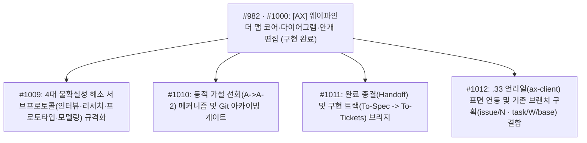

# #982 — Matt Pocock의 Wayfinder 정밀 분석 및 AX 클러스터 의존성 그래프(DAG) 기획/분해 체계 이식·실전 검토 보고서

> 2026-11-18 (초판) · 2026-11-19 (구현 대조 및 4인 언리얼 운영 환경 실전 검토 개정) · Antigravity 리서치 보고서  
> 관련 일감: Redmine `#982` (웨이파인더 맵 코어·표면 완료), `#1000` (안개·범위 밖·목적지 편집 완료)  
> 파생 아이디어 일감: Redmine `#1009` · `#1010` · `#1011` · `#1012` · `#1013` · `#1014` · `#1015`  
> 선행 참고 일감: Redmine `#952`~`#955` (`pstack` 플레이북 종합 분석 및 클러스터 이식 아이디어 아카이브)  
> 분석 대상: `https://github.com/mattpocock/skills` (`skills/engineering/wayfinder/SKILL.md`) 및 AX 클러스터 실제 구현(`master/wayfinder.py`, `master/issue_flow.py`, `master/issue_infra.py`, `master/issue_lock.py`, `master/work/branch_names.py`)  
> 목적: Matt Pocock의 Wayfinder 사양과 `#982`·`#1000` 실제 구현물을 대조하고, **"4명의 작업자가 각자 마일스톤에서 자기 Root 티켓을 전담 할당받아 하나의 Redmine과 하나의 Git 레포로 언리얼(UE5) 프로젝트를 관리하는 실제 회사 환경"**과 기존 단일/분산 브랜치 구획 모델을 기준으로 부족한 점·우려 사항·보완 설계를 정리함.

---

## 1. 개요 및 배경

대형 피처 개발이나 아키텍처 개편처럼 불확실성이 크고 여러 세션에 걸쳐 진행되는 거대 작업을 단일 선형 플로우(`ax:plan`의 단순 T1→T2→T3)로 다룰 경우, 다음과 같은 엔지니어링 문제가 발생한다:
1. **컨텍스트 오염 및 토큰 소진**: 수많은 결정과 세부 구현이 한 세션에 뒤섞여 LLM의 주의력이 급격히 분산되고 환각이 증가함.
2. **조기 구현(Premature Building)의 함정**: 핵심 불확실성과 아키텍처 제약이 해소되지 않은 상태에서 성급히 코드를 작성하다가 후반부에 구조적 결함이 드러나 전체 작업을 엎어야 함.
3. **독자적 설계 결정**: 사용자가 결정해야 할 핵심 비즈니스/기획 갈림길을 에이전트가 임의로 닫아버림.

Matt Pocock의 **Wayfinder**는 **"전장의 안개(Fog of War) 속에서 목적지는 알지만 경로는 보이지 않는 대규모 프로젝트"**를 다루기 위해 만들어진 계획(Planning) 오케스트레이션 프레임워크다.

---

## 2. Matt Pocock의 Wayfinder 실제 소스 및 핵심 아키텍처 정밀 분석

### 2.1 핵심 철학: The Fog of War & Planning, Not Building
- **Planning, Not Building (구현 절대 금지)**:
  - Wayfinder 원본에서는 지도가 활성화된 동안 제품 코드를 작성하지 않고, 각 티켓의 산출물을 **'결정(Decision)'** 혹은 **'불확실성의 해소'**로 한정한다.
- **The Fog of War (전장의 안개)**:
  - 아직 도달하지 않은 영역은 억지로 쪼개지 않고 안개(`Not yet specified`) 속에 남겨두며, 바로 앞의 불확실성을 해결함으로써 안개를 점진적으로 걷어낸다.
- **One Ticket Per Session (단일 세션 단일 티켓 원칙)**:
  - 하나의 티켓은 하나의 독립된 에이전트 세션 내에서 완결되도록 스코프를 제한하여 컨텍스트 위생(Context Hygiene)을 유지한다.

### 2.2 The Map 구조 (`wayfinder:map`) 및 The Frontier
1. **`Destination` (최종 목적지)**: 프로젝트가 궁극적으로 도달해야 하는 완료 상태.
2. **`Decisions so far` (확정된 결정 목록)**: 이미 해결된 티켓의 결론을 **1티켓 1줄 링크 형식**으로 누적 기록하여, 다음 세션에서 이전 티켓을 일일이 다시 열지 않고도 지도만 보고 맥락을 파악하게 함.
3. **`The Frontier` (개척 전선)**: 의존성 그래프(DAG) 상에서 모든 선행 차단 조건(Blocker)이 해결되어 지금 당장 착수 가능한 티켓들의 집합.
4. **`Not yet specified` (미확정 안개)** & **`Out of scope` (범위 밖)**.

### 2.3 불확실성 해소 4대 서브스킬 및 Handoff
- **`/grilling`**(심층 인터뷰), **`/research`**(코드·기술 조사), **`/prototype`**(검증용 일회성 프로토타입), **`/domain-modeling`**(엔티티·불변식 모델링).
- 안개가 모두 걷히면 `/to-spec` → `/to-tickets` → `/implement`로 핸드오프.

---

## 3. `#982`·`#1000` 실제 구현 현황 및 후속 아이디어 일감(`#1009`~`#1012`)

### 3.1 구현 완료된 본체 자산 (`#982` 리포트 206 · `#1000` 리포트 207)
- **`master/redmine.py`**: `create_relation`, `list_relations`, `delete_relation`, `blocked_by`, `blocks_of` 관계 API 배선.
- **`master/map_block.py` & `master/map_diagram.py`**: Root 본문 `ax:map`(`목적지`·`다이어그램`·`노드`·`안개`·`범위 밖`) 및 노드 본문 `ax:node`(`root`·`type`) 파서/렌더러, `blocks` 깊이별 ASCII 박스 다이어그램 자동 생성.
- **`master/wayfinder.py`**:
  - 맵 생성(`create_map`), 상태·대조(`status`/`check`), 동기화(`sync`/`on_node_closed`), 새 노드 제안·등록(`propose_node`/`register_node` + `graduates` 안개 자동 졸업), 지도 편집 7종(`propose_edit`/`apply_edit`: `fog_add`, `fog_resolve`, `fog_to_out`, `destination`, `out_edit`, `out_to_fog`, `node_out`), 선점(`claim`), 재검증(`mark_verified`), Root 마감(`close_root`).
  - **Redmine 실물 제약 해결**: Redmine에서는 모든 노드를 Root의 직속 하위 일감으로 두고, 파생 트리는 지도 표의 「부모」 칸에만 유지하며 선후 관계는 형제 간 `blocks`로 연결.
- **`master/issue_flow.py` & `master/skills/ax-wayfinder/SKILL.md`**:
  - `issue_finish` 시 `on_node_closed` 자동 갱신 훅, `ax-projects` MCP 도구 10종, 신규 기능(`feature`) 분류 시 `wayfinder_ask` 발동 질문.

---

## 4. 운영 전제와 기존 브랜치 구획 자산 대조

### 4.1 회사의 실제 운영 토폴로지
- **작업자 구성 및 저장소 분리 (Git + Perforce 하이브리드)**:
  - 약 4명의 작업자가 **하나의 Redmine**을 공유하여 **언리얼 엔진(UE5) 프로젝트**를 개발.
  - **C++ 소스 코드**는 **하나의 Git 저장소(Gitea)**로 관리하고, **언리얼 바이너리 에셋(`.uasset`, `.umap`, `Content/**`)은 Perforce(P4)**로 관리한다.
- **티켓 할당 방식 (1인 1 Root 전담)**:
  - 하나의 Root 티켓에 여러 명이 동시에 붙어 수정하는 것이 아니라, **마일스톤에서 작업자 1명이 자기 피처의 Root 티켓 1개를 전담 지정받아 그 안의 지도와 하위 노드들을 주도적으로 굴린다.** (따라서 같은 Root 본문을 타인이 동시에 고쳐서 생기는 경합은 없음).
  - 반면 **4명의 작업자가 각자 자기가 맡은 서로 다른 티켓(Root/노드 또는 단일 일감)을 동일한 Redmine 프로젝트와 동일한 Git/Perforce 위에서 동시에 진행**한다.

### 4.2 기존 AX 클러스터의 브랜치·작업 구획 분리 메커니즘 참조
이미 클러스터에는 단일 작업과 분산 작업을 위한 두 가지 견고한 브랜치 격리 모델이 구현되어 있다:
1. **단일 일감 구획 (`master/issue_flow.py`, `master/issue_infra.py`, `master/client/skills/ax-issue/SKILL.md`)**:
   - 요청자 PC(`.33` 등)에서 사람의 메인 작업 트리(`$repo`, 미커밋 `.uasset` 존재 가능)를 건드리지 않고 옆 디렉터리에 **`$name-issue-$N` worktree와 `issue/<N>` 로컬 브랜치**를 세워 작업한다.
   - 완료 시 `origin main`에 fast-forward push 한 뒤, 마스터(`infra_finish`)가 Gitea bare 저장소에서 `base..end` 커밋 실재 여부와 `main` 도달 가능성을 검증(`#933`)하고 일감을 닫는다.
2. **분산 작업 3-Tier 계층형 브랜치 구획 (`master/work/branch_names.py`, `master/work/subbranch.py`)**:
   - `task/<work_id>/base` (작업 베이스 브랜치: 골조가 실물로 올라가는 자리)
   - `task/<work_id>/r<round>/<task_id>` (조각 durable 브랜치: `subbranch.create`가 worktree 없이 `git push <remote> <base_commit>:refs/heads/...`로 원격 ref만 생성)
   - `attempt/<work_id>/<task_id>/<workshop>/<ts>` (워커 시도 브랜치)
   - 라운드 완료 시 조각들을 `task/<work_id>/base`로 전진(`ax-advance`)시키고, 최종 검증 후 `main`에 반영(`ax-review`)한다.

---

## 5. Wayfinder 원본 대조 및 4인 언리얼 환경에서의 핵심 부족점·우려 사항 5가지

위의 **"1인 1 Root 전담 + 4인 동시 단일 Redmine/Git 언리얼 개발 + 기존 브랜치 구획 참조"** 조건에서 실제 코드를 점검한 결과, 반드시 짚어야 할 5가지 구조적 병목과 보완점이다.

### 5.1 [치명적 병목] 프로젝트당 1칸뿐인 일감 잠금(`issue_lock.json`)으로 인한 4인 동시 작업 차단
- **코드 근거**:
  - `master/issue_infra.py:21-24` 및 `master/issue_lock.py:41-55`를 보면, 일감 잠금 파일이 `<프로젝트 트윈 루트>/issue_lock.json` **단 하나**이며, 그 안의 활성 슬롯이 프로젝트 전체에 **`"active": None` 단 1칸**뿐이다(`#883` 일감 하나씩 규칙).
- **4인 환경에서의 문제**:
  - 작업자 1명이 1개의 Root/노드 티켓을 맡더라도, 4명이 같은 언리얼 프로젝트(예: `NS`)에 속해 있다.
  - **작업자 A가 자기 PC에서 자기 노드 `#1001`을 `ax-client:issue_start`로 시작하는 순간, 프로젝트 트윈의 유일한 `active` 잠금을 `#1001`이 차지해버린다.**
  - 직후 **작업자 B가 자기 티켓 `#1050`을 `issue_start` 하려고 하면, 마스터 서버가 `"이미 활성 일감 #1001 이 있다 — 완료·보류·취소 전에는 다른 일감을 시작하지 않는다"`며 거절**한다!
  - 즉, 현재 잠금 구조 그대로는 4명 중 1명이 일감을 시작하면 나머지 3명은 일감을 시작(`issue_start`)할 수 없고 앞 사람이 끝내거나 `issue_pause`를 해줄 때까지 기다려야 한다.
- **해결 설계**:
  - `issue_lock.json`의 `active` 슬롯을 프로젝트 전역 1칸이 아니라 **작업자(Redmine 담당자 또는 요청자 워크숍/PC 식별자 `owner`)별 `active` 맵(`active_by_owner: {"workerA": {...}, "workerB": {...}}`)**으로 분리해야 4명이 각자 자기 티켓을 동시에 1개씩 진행할 수 있다.

### 5.2 [Wayfinder 원본 대비 부족] 노드 마감 시 결정 요약(`Decisions so far`)이 지도 표에 반영되지 않음
- **코드 근거**:
  - Wayfinder 원본의 가장 큰 강점은 여러 세션에 걸쳐 장기 작업을 할 때, 이전 티켓에서 내린 결정이 지도 본문(`Decisions so far`)에 한 줄씩 요약 누적되어 **다음 세션의 에이전트가 옛날 티켓들을 다시 열어보지 않고도 지도 본문 하나만 읽고 전체 맥락을 복원**하는 것이다.
  - 반면 현재 `master/wayfinder.py:598-608`(`_sync`)은 노드가 마감될 때 `n.state = DONE`으로 상태만 바꿀 뿐, **지도 표의 `요약` 칸(`n.summary`)은 노드를 처음 만들 때 적었던 초기 문구 그대로 남겨둔다.**
- **1인 장기 작업에서의 문제**:
  - 작업자 1명이 며칠에 걸쳐 여러 세션으로 Root 지도를 굴릴 때, `프리필(사전조사)` 노드가 완료되었는데도 지도 표의 요약 칸에는 초기 질문(*"어떤 구조로 할지 조사"*)만 적혀 있고 **실제 확정된 결론**이 지도에 나타나지 않는다. 결국 새 세션마다 완료된 하위 일감들을 다시 조회해야 해서 컨텍스트 절약 효과가 반감된다.
- **해결 설계**:
  - `on_node_closed(issue_id)`가 호출될 때(또는 `issue_finish` 시), 닫힌 노드 일감의 최신 완료 노트나 스펙/결론 한 줄을 추출해 **Root 지도 표의 해당 노드 `요약` 칸을 실제 결과 요약으로 자동 갱신**하도록 보완한다.

### 5.3 [기존 브랜치 구획 연계] 단일 `issue/<N>`(`main` 직결) vs 분산 `task/<W>/base`(Root 베이스 브랜치) 선택 구조
- **코드 근거**:
  - 현재 단일 일감 마감(`master/issue_infra.py:28-30`)은 **노드의 끝 커밋(`end`)이 반드시 `origin/main`에 먼저 푸시(도달 가능)되어 있어야만** 마감을 승인한다.
- **언리얼 4인 개발에서의 문제**:
  - 웨이파인더로 쪼갠 노드 5개(`#1001` 코어 구조체 추가 → `#1002` 데이터 테이블 변경 → `#1003` UI 연동 ...)를 순서대로 진행할 때, `#1001` 하나 끝났다고 바로 `origin/main`에 푸시해버리면 **아직 미완성인 피처 코드나 실험 중인 구조가 `main`에 들어가 다른 작업자 3명의 언리얼 빌드/에디터를 오염**시킬 수 있다.
- **해결 설계 (기존 분산 작업의 `branch_names.py`·`subbranch.py` 그대로 활용)**:
  - 이미 우리 클러스터의 분산 작업(`master/work/branch_names.py`)에 **`task/<work_id>/base`(베이스 브랜치) ➔ `task/<work_id>/<task_id>`(서브 브랜치)** 규약이 완벽히 구현되어 있다.
  - 이를 그대로 참조하여 웨이파인더에서도:
    1. Root 맵 생성 시 원격에 **`issue/<root_id>/base` (Root 베이스 브랜치)** ref를 세운다(`subbranch.py`처럼 worktree 없이 `git push origin <main_sha>:refs/heads/issue/<root_id>/base`).
    2. 각 하위 노드(`#N`)는 `main`이 아니라 **`issue/<root_id>/base`에서 갈라진 `issue/<root_id>/<node_id>`**에서 작업하고, 노드 마감(`issue_finish`) 시 `main`이 아닌 **`issue/<root_id>/base`로 fast-forward push**하도록 `verify_span`의 대상 브랜치만 `issue/<root_id>/base`로 지정한다.
    3. 모든 노드가 완료된 뒤 **`close_root`(Root 마감) 시점에 `issue/<root_id>/base`를 `origin/main`으로 최종 반영**하면, 작업 중에는 다른 3명의 `main`을 전혀 오염시키지 않으면서 기존 단일/분산 브랜치 코드를 100% 재사용할 수 있다.

### 5.4 [언리얼 프로젝트 특화] Perforce(P4) 체크아웃 검사를 통한 에셋 충돌 방지 및 Worktree 빌드 캐시 유지
- **원인 및 운영 환경 특성**:
  1. **언리얼 바이너리 에셋(`.uasset`, `.umap`)의 Perforce 관리**: 회사의 언리얼 프로젝트에서 바이너리 에셋은 Git이 아니라 **Perforce(P4)**로 관리되고 있다. 따라서 마스터가 별도의 에셋 잠금 DB를 만들 필요 없이, 작업 착수 전 **Perforce 서버의 체크아웃 상태(`p4 opened -a` / `p4 fstat`)만 조회**하면 다른 작업자(4명 중 타인)가 해당 에셋을 이미 체크아웃해서 수정 중인지 100% 정확하게 판별할 수 있다.
  2. **언리얼에서 `git worktree` 생성 시 C++ 빌드 캐시 비용 (`ax-issue/SKILL.md` §2)**: 에셋이 Perforce에 있더라도, 일감(노드)마다 옆 폴더에 새 Git worktree(`$name-issue-$N`)를 매번 새로 파면 `Intermediate/`, `Binaries/` 폴더가 비어 있어 노드 5개짜리 지도를 굴릴 때마다 C++ 풀 리빌드가 발생할 수 있다.
- **해결 설계**:
  1. **Perforce 체크아웃 사전 검사 (`p4 opened -a`)**: 노드 또는 태스크 착수(`issue_start` / `plan_start`) 시 플랜의 대상(`target`)에 포함된 언리얼 에셋 경로에 대해 `p4 opened -a <경로>`를 실행하여, **다른 작업자가 이미 체크아웃(Exclusive Lock)한 에셋이 있으면 작업 착수 전에 누구에게 잠겨 있는지 즉시 알려주고 블로커로 안내**한다.
  2. **언리얼 작업장 고정 Worktree 재사용**: 언리얼 프로젝트(`kind: unreal`)에서는 노드마다 새 디렉터리(`$name-issue-$N`)를 만들었다 지우지 않고, **하나의 전용 작업 worktree(또는 작업 구획) 안에서 브랜치만 `issue/<root>/base` → `issue/<root>/<node>`로 전환(switch)**하여 `Intermediate`/`Binaries` 빌드 캐시와 Perforce 워크스페이스 매핑을 그대로 유지한다.

### 5.5 [클라이언트 배선 및 재검증 범위] `.33` 등 클라이언트 마감 훅 미배선 및 `재검증 B`의 불필요한 확산
- **코드 근거**:
  1. **클라이언트 마감 훅 누락**: 현재 `wayfinder.on_node_closed` 훅은 마스터 로컬용 `issue_flow.finish`에만 연결되어 있고, 언리얼 작업자 PC들이 호출하는 `issue_infra.infra_finish`(`8101 /api/v1/issue/finish`)에는 아직 연결되어 있지 않다(리포트 206 §5). 또한 `ax-client` MCP에 `wayfinder_*` 도구가 아직 노출되지 않았다.
  2. **`재검증 B`의 범위**: `wayfinder.py:679-688`에서 하위 가지 말단에 노드를 하나 추가할 때 Root 직속의 무관한 상위 완료 형제들까지 무조건 전부 `재검증(REVERIFY)`으로 바꾸고 그 후속 노드들을 `차단(BLOCKED)`으로 잠근다. 언리얼처럼 재검증(빌드+PIE 실행)이 무거운 환경에서는 작업자가 자기 지도 말단에 작은 노드를 추가할 때마다 이미 끝낸 다른 큰 줄기까지 일일이 `mark_verified`를 다시 쳐야 하는 피로도가 생길 수 있다.
- **해결 설계**:
  - `issue_infra.finish_record`에 `on_node_closed` 훅을 연결하고 `ax-client`에 웨이파인더 도구를 대칭 노출한다(`#1012`).
  - `register_node` 시 `reverify` 목록 중 실제로 재검증이 필요한 노드만 선택하거나 건너뛸 수 있는 옵션을 제공하여 불필요한 반복 빌드를 줄인다.

---

## 6. 종합 요약: 4인 언리얼 팀 운영을 위한 우선 보완 체크리스트 및 연결 일감

| 우선순위 | 보완 항목 | 참조 자산 및 등록된 Redmine 일감 | 기대 효과 |
| :---: | :--- | :--- | :--- |
| **1순위 (필수)** | **일감 잠금(`issue_lock.json`)을 프로젝트 전체 1칸에서 작업자(Owner/PC)별 1칸으로 분리** | `master/issue_lock.py` `master/issue_infra.py` ➔ 일감 [`#1013`](http://192.168.0.57:8080/issues/1013) | 4명의 작업자가 같은 언리얼 프로젝트에서 각자 자기 티켓을 블로킹 없이 동시에 `issue_start` 가능 |
| **2순위 (필수)** | **클라이언트 마감(`issue_infra.infra_finish`)에 `on_node_closed` 연결 및 `ax-client` 도구 노출** | `master/issue_flow.py:583` `master/client/spec.py` ➔ 일감 [`#1012`](http://192.168.0.57:8080/issues/1012) | 언리얼 작업자 PC에서 노드를 마감해도 Root 지도의 상태와 Frontier가 자동 전진 |
| **3순위 (브랜치/캐시)** | **기존 분산 작업(`task/<W>/base`)을 참조한 `issue/<root>/base` ➔ `issue/<root>/<node>` 구획 분리 + 고정 Worktree 캐시 유지** | `master/work/branch_names.py` `master/work/subbranch.py` ➔ 일감 [`#1012`](http://192.168.0.57:8080/issues/1012) · [`#1015`](http://192.168.0.57:8080/issues/1015) | 피처가 다 끝날 때까지 다른 3명의 `main`을 오염시키지 않고, 언리얼 `Binaries`/`Intermediate` 재빌드 시간 절약 |
| **4순위 (맥락/P4)** | **노드 마감 시 결정 한 줄을 지도 `요약` 칸에 자동 반영 + Perforce(`p4 opened -a`) 에셋 체크아웃 사전 검사** | `master/wayfinder.py:606` `master/plan_tools.py` ➔ 일감 [`#1014`](http://192.168.0.57:8080/issues/1014) · [`#1015`](http://192.168.0.57:8080/issues/1015) | 다음 세션에서 지도만 보고 선행 결정 파악 가능, P4 체크아웃 조회로 4인 간 언리얼 에셋 충돌 사전 확인 |
