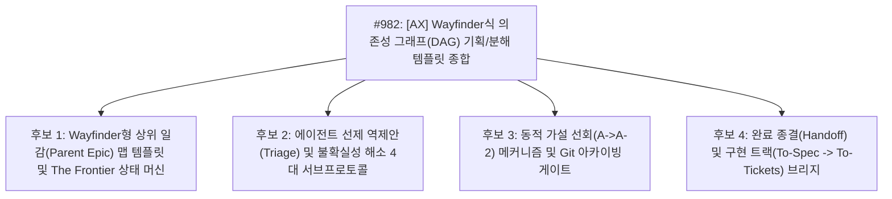

# #982 — Matt Pocock의 Wayfinder 정밀 분석 및 AX 클러스터 의존성 그래프(DAG) 기획/분해 체계 이식 설계

> 2026-11-18 · Antigravity 리서치 보고서  
> 관련 일감: Redmine `#982` (`[AX] 대형 일감의 Wayfinder식 의존성 그래프(DAG) 기획/분해 템플릿 도입 검토`)  
> 선행 참고 일감: Redmine `#952`~`#955` (`pstack` 플레이북 종합 분석 및 클러스터 이식 아이디어 아카이브)  
> 분석 대상: `https://github.com/mattpocock/skills` (`skills/engineering/wayfinder/SKILL.md`, `docs/engineering/wayfinder.md`)  
> 목적: Matt Pocock의 Wayfinder 실제 사양을 정밀 분석하고, `#952`~`#955` 일감 분해 패턴과 동일하게 AX 클러스터의 대형 일감(Epic/대형 리팩토링) 관리에 이식할 핵심 메커니즘과 하위 일감 후보를 도출함.

---

## 1. 개요 및 배경

대형 피처 개발이나 아키텍처 개편(예: 매칭 시스템 전면 개편, 분산 큐 고도화 등)처럼 불확실성이 크고 여러 세션에 걸쳐 진행되는 거대 작업을 단일 선형 플로우(`ax:plan`의 단순 T1→T2→T3)로 다룰 경우, 다음과 같은 심각한 엔지니어링 문제가 발생한다:
1. **컨텍스트 오염 및 토큰 소진**: 수많은 결정과 세부 구현이 한 세션에 뒤섞여 LLM의 주의력이 급격히 분산되고 환각이 증가함.
2. **조기 구현(Premature Building)의 함정**: 핵심 불확실성과 아키텍처 제약이 해소되지 않은 상태에서 성급히 코드를 작성하다가, 후반부에 구조적 결함이 드러나 전체 작업을 엎어야 함.
3. **독자적 설계 결정**: 사용자가 결정해야 할 핵심 비즈니스/기획 갈림길을 에이전트가 임의로 닫아버림.

Matt Pocock의 **Wayfinder**는 **"전장의 안개(Fog of War) 속에서 목적지는 알지만 경로는 보이지 않는 대규모 프로젝트"**를 다루기 위해 만들어진 계획(Planning) 전용 오케스트레이션 프레임워크다. 본 보고서는 Wayfinder의 원전 철학과 구체적 메커니즘을 전수 분석하고, 이를 AX 클러스터의 Redmine 오케스트레이션에 접목하는 방안을 제시한다.

---

## 2. Matt Pocock의 Wayfinder 실제 소스 및 핵심 아키텍처 정밀 분석

### 2.1 핵심 철학: The Fog of War & Planning, Not Building
- **Planning, Not Building (구현 절대 금지)**:
  - Wayfinder가 활성화되어 있는 동안 에이전트는 **단 한 줄의 제품 코드도 작성하지 않는다.**
  - 모든 작업의 산출물은 코드가 아니라 **'결정(Decision)'** 혹은 **'불확실성의 해소'**다.
- **The Fog of War (전장의 안개)**:
  - 거대한 프로젝트의 세부 경로를 처음부터 완벽하게 알 수는 없다.
  - 아직 도달하지 않은 영역은 억지로 쪼개지 않고 안개(`Not yet specified`) 속에 남겨두며, 바로 앞의 불확실성을 해결함으로써 안개를 점진적으로 걷어낸다.
- **One Ticket Per Session (단일 세션 단일 결정 원칙)**:
  - 하나의 의사결정 티켓은 하나의 독립된 에이전트 세션(~100k 토큰) 내에서 완전히 해결되도록 스코프를 제한하여 컨텍스트 위생(Context Hygiene)을 유지한다.

### 2.2 The Map 구조 (`wayfinder:map`)
Wayfinder의 중심 허브는 이슈 트래커(GitHub Issues, GitLab, Redmine 등)에 생성되는 단 하나의 **지도(Map) 이슈**다. 지도는 프로젝트 진행 상황을 추적하는 단일 정본(Single Source of Truth) 역할을 하며, 항상 다음 4대 섹션을 유지한다:
1. **`Destination` (최종 목적지)**:
   - 이번 프로젝트가 궁극적으로 도달해야 하는 완료 상태 및 성공 기준.
2. **`Decisions so far` (확정된 결정 목록)**:
   - 이미 해결된 결정 티켓의 요약 목록.
   - **1티켓 1줄 링크 형식**(`- #101 매칭 큐 구조: Redis Sorted Set 채택 (#101)`)으로 기록하여 본문 비대화를 방지하고, 상세 논거는 개별 티켓에 보존한다.
3. **`Not yet specified` (미확정 안개 영역)**:
   - 앞으로 해결해야 하지만 선행 조건이 충족되지 않아 아직 구체적 티켓으로 발번할 수 없는 거친 주제들.
4. **`Out of scope` (범위 외 배제 항목)**:
   - 의도적으로 이번 작업 범위에서 제외하기로 합의된 사항들.

### 2.3 The Frontier (개척 전선)와 상태 전이 라이프사이클
- **The Frontier의 정의**:
  - 의존성 그래프(DAG) 상에서 **모든 선행 차단 조건(Blocker)이 해결되어 지금 당장 착수 가능한 결정 티켓들의 집합**이다.
- **티켓 라이프사이클**:
  - `Blocked (대기)`: 선행 결정 티켓이 아직 열려 있어 착수할 수 없는 상태.
  - `Frontier (착수 가능)`: 모든 블로커가 닫혀 에이전트나 사람이 즉시 조사/결정할 수 있는 상태.
  - `In Progress (진행 중)`: 해당 티켓의 결정을 내리기 위해 서브스킬을 수행 중인 상태.
  - `Resolved / Closed (완료)`: 결정이 내려지고 지도 본문의 *Decisions so far*에 기록된 상태. 선행 조건 완료에 따라 후속 `Blocked` 티켓들이 `Frontier`로 승격된다.

### 2.4 불확실성 해소 4대 전용 서브스킬 결합
티켓을 해결할 때 에이전트는 불확실성의 성격에 따라 4가지 특화 서브스킬을 적재적소에 호출한다:
1. **`/grilling` (심층 인터뷰)**:
   - 사용자의 머릿속에만 있는 암묵적 의도, 비즈니스 룰, 엣지케이스를 집요한 질의응답을 통해 밖으로 끄집어냄.
2. **`/research` (심층 맥락·외부 기술 조사)**:
   - 기존 코드베이스의 실제 구현 라인과 외부 라이브러리/문서를 조사하여 기술적 실현 방안 도출.
3. **`/prototype` (검증용 일회성 프로토타입)**:
   - 제품 코드가 아닌 임시 스크립트/테스트 하네스를 작성하여 가정의 성립 여부만 확인하고 폐기.
4. **`/domain-modeling` (도메인 모델링)**:
   - 엔티티, 상태 머신, 데이터 불변식(Invariants)을 형식화.

### 2.5 Stop Condition & Handoff (종결 및 구현 트랙 전환)
- **종결 조건 (Stop Condition)**:
  - *Not yet specified*의 모든 안개가 걷히고, 모든 결정 티켓이 *Decisions so far*로 전환되면 Wayfinder는 자동으로 탐색을 멈춘다.
- **클린 핸드오프 (Handoff)**:
  - 기획이 끝난 후 정제된 결정을 `/to-spec` 스킬을 통해 최종 기능 명세서로 합성하고, `/to-tickets`를 통해 실행 가능한 작은 구현 티켓(Tracer bullets)으로 쪼갠 뒤 실제 구현(`/implement`)으로 넘긴다.

---

## 3. AX 클러스터 vs Wayfinder 1:1 대조 분석

| 비교 축 | Wayfinder (`mattpocock/skills`) | AX 클러스터 (`AXCluster`) | 시사점 및 접목 방향 |
| :--- | :--- | :--- | :--- |
| **운영 철학** | *Plan, don't build* (구현 전 안개 해소) | *읽어서 확인하지 말고 돌려서 확인한다* (실증 주의) | 기획 단계에서는 철저한 결정 중심, 구현 단계에서는 철저한 실증 중심으로 명확히 분리 |
| **작업 단위** | 단일 세션당 1 결정 티켓 | 태스크 단위 완결 및 세션별 인수인계 (`ax-handoff`) | 대형 작업을 단일 `ax:plan`에 몰아넣지 않고, 세션 경계에 맞는 하위 일감으로 격리 |
| **추적 도구** | GitHub/GitLab Issues (`wayfinder:map`) | Redmine 이슈 (`parent_issue_id`, `blocks/blocked_by`) | Redmine의 부모-자식 트리 및 차단 관계를 DAG 그래프 엔진으로 100% 활용 |
| **그래프 시각화** | 마크다운 체크리스트 / 이슈 링크 | Unicode/ASCII 박스 다이어그램 | 플러그인 없는 순수 Redmine 본문/노트에서 한눈에 보이는 DAG 맵 렌더링 |
| **진행 제어** | 단일 선형 vs 복합 구분 없음 | **투 트랙(Two-Track) 분기** (단일 `ax:plan` vs DAG 맵) | 오버헤드 방지를 위해 단순 작업은 기존 `ax:plan`, 대형/모호 작업만 DAG 분해 적용 |
| **안전장치** | 맵 상의 텍스트 취소선/수정 | **동적 가설 선회(A→A-2) + Git 아카이빙 게이트** | 가설 폐기 시 Git 브랜치 보존 및 후속 태스크 순행 폐기 사람 게이트 도입 |
| **전파 방식** | 단일 레벨 부모 이슈 갱신 | **다계층 재귀 상향 전파 (Recursive Bubble-up)** | Root ➔ 중간 에픽 ➔ 말단 태스크 다계층 구조에서 자동 상태 전파 |

---

## 4. `#952`~`#955` 패턴을 따른 하위 구현/이식 아이디어 4종

`#952`가 `pstack`의 종합 분석 후 `#953`(반복 실수 차단), `#954`(기준선 및 미지 우선), `#955`(Slop 정제 및 파급 실측)로 분할했던 것과 동일하게, `#982`를 바탕으로 다음 4가지 핵심 하위 아이디어 일감 후보를 도출한다.

### [일감 후보 1] Wayfinder형 상위 일감(Parent Epic) 맵 템플릿 및 The Frontier 상태 머신
- **원전 출처**: Wayfinder `The Map` (`wayfinder:map`) & `The Frontier`
- **문제 의식**:
  - 대형 프로젝트를 여러 자식 일감으로 쪼개도, 전체 진행 상태와 다음 작업 대상이 한눈에 파악되지 않으면 부모 일감이 방치되거나 병목이 발생함.
- **핵심 메커니즘**:
  1. **Unicode/ASCII DAG 맵 템플릿**: Redmine 본문에 선행-후속 차단 관계와 현재 Frontier 위치를 텍스트 박스 다이어그램으로 가시화.
  2. **Redmine 메타데이터 연동**: `parent_issue_id`와 `blocks / blocked_by` 링크를 생성 시점에 자동 구성.
  3. **Recursive Bubble-up (상향식 재귀 전파)**:
     - 말단 자식 일감 마감 시 직속 부모 맵의 노드를 `[완료]` 처리하고, 후속 일감을 `[Frontier: 착수 가능]`으로 승격.
     - 직속 부모의 모든 선행 조건이 충족되면 그 상위 부모(Grandparent/Root)로 상태를 재귀 전파.
- **AX 클러스터 구현처**:
  - `master/wayfinder_map.py` (신규 DAG 파서 및 ASCII 렌더러 모듈)
  - `master/plan_start.py` / `master/issue_wrapup.py` 마감 훅 연계.

### [일감 후보 2] 에이전트 선제 역제안(Triage/Trigger) 및 불확실성 해소 4대 서브프로토콜
- **원전 출처**: Wayfinder 4대 서브스킬 (`/grilling`, `/research`, `/prototype`, `/domain-modeling`)
- **문제 의식**:
  - 사용자가 거대한 요구사항을 던졌을 때 에이전트가 무비판적으로 바로 단일 `ax:plan` 체크리스트를 짜서 코딩을 시작하다가 실패함.
- **핵심 메커니즘**:
  1. **역제안 트리거 (Triage)**:
     - 모호성/기술적 불확실성이 크거나 영향 범위(모듈 수)가 방대함을 감지하면, 에이전트가 코딩에 착수하지 않고 *"이 작업은 불확실성과 범위가 크므로 상위 일감(Epic) + DAG 의존성 맵으로 분해하여 선행 결정을 내릴 것을 제안합니다"*라고 역제안.
  2. **불확실성 해소 4대 전용 태스크 프로토콜**:
     - 자식 일감 유형을 `사양 인터뷰(Grilling)`, `기술 리서치(Research)`, `실증 프로토타입(Prototype)`, `도메인 모델링(Modeling)`으로 규격화하여 각 티켓의 산출물을 '결정'으로 한정.
- **AX 클러스터 구현처**:
  - `skills/ax-plan/SKILL.md` 착수 시 2-트랙 분기 판정 로직 추가.
  - `skills/debate/SKILL.md` 및 `interview_spec.py` 도구와의 연계.

### [일감 후보 3] 동적 가설 선회(A -> A-2) 메커니즘 및 Git 아카이빙 게이트
- **원전 출처**: Wayfinder Invalidation & Rerouting
- **문제 의식**:
  - 프로토타입 검증이나 리서치 도중 기존 가설(A)이 틀렸음이 밝혀졌을 때, 기존 작업 트리에 덮어쓰기를 하거나 후속 일감들이 낡은 가설을 바라보고 잘못 수행되는 문제.
- **핵심 메커니즘**:
  1. **Git 아카이빙 게이트 (사람 게이트)**:
     - 가설 폐기 전, *"A 방식을 폐기하고 A-2로 전환합니다. 기존 A 작업 내용을 Git 브랜치(`archive/issue-xxx-attempt-A`)나 태그로 보존해 둘까요?"* 확인 후 작업 트리 클린 리셋.
  2. **후속 일감 순행 추적 폐기/대기**:
     - DAG 그래프를 따라 A에 물려 있던 하위 의존 일감들을 자동으로 `[가설 폐기]` 처리하거나 `[A-2 사양 확정 후 재검토]` 상태로 변경.
  3. **최종 통합 검증 일감(Z)의 지연 활성화**:
     - 선회한 새로운 경로(A-2)가 최종단까지 도달하기 전에는 결코 통합 검증 단계가 열리지 않도록 차단 유지.
- **AX 클러스터 구현처**:
  - `master/work/` 내 가설 변경 시 브랜치 아카이빙 자동화 스크립트.
  - Redmine 관계 연동 기반 순행 무효화(Cascade Invalidation) 로직.

### [일감 후보 4] 완료 종결(Handoff) 및 구현 트랙(To-Spec -> To-Tickets -> Implement) 브리지
- **원전 출처**: Wayfinder Handoff (`/to-spec` -> `/to-tickets` -> `/implement`)
- **문제 의식**:
  - 기획/결정 맵이 모두 완료되었을 때, 이를 실제 구현 단계(워커 분산, `ax:plan`, `distribute`)로 매끄럽게 넘겨주는 브리지가 부족함.
- **핵심 메커니즘**:
  1. **Root 일감 최종 종결 사람 게이트**:
     - 모든 하위 안개가 걷히고 결정이 확정되면, 마스터가 독자 마감하지 않고 *"모든 사전 결정과 검증이 완료되었습니다. Root 기획 일감을 최종 마감하고 실제 구현 트랙으로 전환할까요?"* 확인.
  2. **To-Spec 합성 및 To-Tickets 구현 분할**:
     - 확정된 *Decisions so far*를 취합하여 `#911` 표준 6대 스펙 문서로 컴파일.
     - 컴파일된 스펙을 바탕으로 실제 구현용 Redmine 일감들을 발번하고, 기존의 `distribute` 워커 파견 또는 로컬 `ax:plan` 선형 실행으로 연결.
- **AX 클러스터 구현처**:
  - `master/plan_transition.py` 및 `master/client/master_local.py` 연계.

---

## 5. 결론 및 향후 추진 방안

1. **리서치 성과**:
   - Matt Pocock의 Wayfinder 철학(Planning Not Building, The Fog of War, The Frontier)을 면밀히 분석하고, 이를 Redmine 중심의 AX 클러스터에 최적화된 **"투 트랙(Two-Track) DAG 오케스트레이션"**으로 구체화함.
2. **권장 액션**:
   - 본 보고서의 분석 내용을 바탕으로 `#982`를 부모 일감으로 유지하고, 상기 도출된 4가지 핵심 영역(맵 템플릿/상태머신, 역제안/서브스킬, 가설선회/아카이빙, 종결/구현브리지)을 하위 아이디어 일감으로 발번하여 `#952`~`#955`와 동일한 체계적인 아카이브 구조를 완성하는 것을 추천함.
